<!-- @@author naieel04 -->

# FinNUS Developer Guide

FinNUS is a command-line personal finance tracker. This guide explains how to set up, understand, extend, and test it.

**Release:** [Release Page](https://github.com/AY2627S1-CS2113-W13-2/tp/releases)

> Status: This guide documents the current implementation and testable behaviour.

---

## Table of contents

- [Acknowledgements](#acknowledgements)
- [Setting up and getting started](#setting-up-and-getting-started)
- [Design](#design)
- [Implementation](#implementation)
- [Documentation, logging, testing, and DevOps](#documentation-logging-testing-and-devops)
- [Product scope](#product-scope)
- [User stories](#user-stories)
- [Use cases](#use-cases)
- [Non-functional requirements](#non-functional-requirements)
- [Glossary](#glossary)
- [Instructions for manual testing](#instructions-for-manual-testing)
- [Planned enhancements](#planned-enhancements)

<!-- @@author -->

---

<!-- @@author naieel04 -->
## Acknowledgements

The following resources support the project and this guide:

- [CS2113 project template](https://github.com/NUS-CS2113-AY2627-S1/tp): provides the starter structure and conventions
  for projects in the CS2113 module.
- [Address Book Level 3](https://se-education.org/addressbook-level3/): reference for code quality, project structure,
  and developer-guide organisation.
- [Gradle](https://gradle.org/): builds the project and runs automated checks and tests.
- [JUnit 5](https://junit.org/junit5/): supports automated unit and integration tests.
<!-- @@author -->

---

<!-- @@author naieel04 -->
## Setting up and getting started

### Prerequisites

- JDK **25**, configured for both the IDE project SDK and Gradle JVM.
- Git and a Java-compatible IDE, such as IntelliJ IDEA.
- Internet access for the initial build to download Gradle and dependencies.

On macOS, use `sdk use java 25.0.3.fx-zulu` if switching Java versions with SDKMAN.

### Importing, building, and running

1. Clone the repository: [W13-2 Repo](https://github.com/AY2627S1-CS2113-W13-2/tp/).
2. Open the repository root containing `build.gradle` and import it as a Gradle project.
3. Confirm that `java -version` reports Java 25 and that the IDE's Gradle JVM uses Java 25.
4. Run the following commands from the repository root.

| Task                     | Windows PowerShell        | macOS / Linux         |
|--------------------------|---------------------------|-----------------------|
| Run from source          | `.\gradlew.bat run`       | `./gradlew run`       |
| Run automated tests      | `.\gradlew.bat test`      | `./gradlew test`      |
| Run tests and Checkstyle | `.\gradlew.bat check`     | `./gradlew check`     |
| Package the application  | `.\gradlew.bat shadowJar` | `./gradlew shadowJar` |

Run the packaged application using `java -jar build/libs/finnus.jar`. Enter `help` to view commands and `exit` to quit.
The application entry point is `finnus.FinNUS`.
<!-- @@author -->

---

<!-- @@author naieel04 -->

## Design

<!-- @@author -->

<!-- @@author naieel04 -->
### Architecture

`FinNUS` coordinates startup, command execution, and persistence. The parser produces command objects, which read or
modify the ledger and display results through the UI. Storage loads and saves complete ledger snapshots.

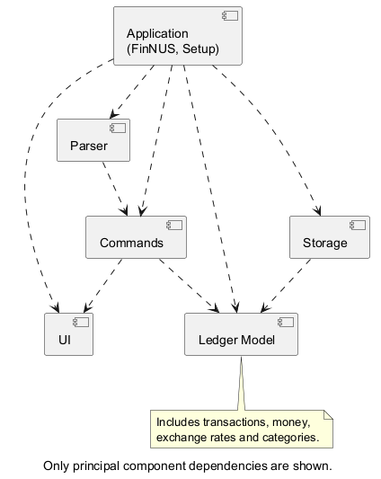

*Figure 1. FinNUS architecture and component dependencies. [PlantUML source](diagrams/ArchitectureDiagram.puml).*

| Component       | Main classes / package                                                  | Responsibility                                                                                               |
|-----------------|-------------------------------------------------------------------------|--------------------------------------------------------------------------------------------------------------|
| Application     | `finnus.FinNUS`, `finnus.Setup`                                         | Restore state, guide first-run setup, run commands, detect changes, save pending state, and handle shutdown. |
| UI              | `finnus.ui.Ui`                                                          | Read console input and display messages, errors, and command results.                                        |
| Parser          | `finnus.parser.Parser`                                                  | Validate command syntax and construct a command.                                                             |
| Commands        | `finnus.command`                                                        | Execute operations through the shared `Command` abstraction.                                                 |
| Ledger model    | `TransactionList`, `Transaction`, `TransactionType`                     | Maintain transactions, opening balance, and balance calculation.                                             |
| Currency model  | `CurrencyRates`                                                         | Maintain user-entered exchange rates relative to SGD.                                                        |
| Category model  | `CategoryList`                                                          | Maintain predefined and custom spending categories for withdrawals.                                          |
| Storage         | `Storage`, `FileStorage`, `LedgerCodec`, `LedgerSnapshot`, `LoadResult` | Encode, persist, validate, and recover financial state.                                                      |
| Expected errors | `FinNusException`                                                       | Carry command failure messages to the application's error handler.                                           |

### Application lifecycle

1. `FinNUS` loads a `LoadResult` through `Storage` and reconstructs the ledger.
2. `Ui` reads a line; `Parser.parse()` validates it and returns a `Command`.
3. The command executes against `TransactionList` and displays its result through `Ui`.
4. `FinNUS` compares ledger snapshots to detect changes and attempts to save pending changes.
5. `exit` or end of input ends the loop; pending changes are retried before shutdown.

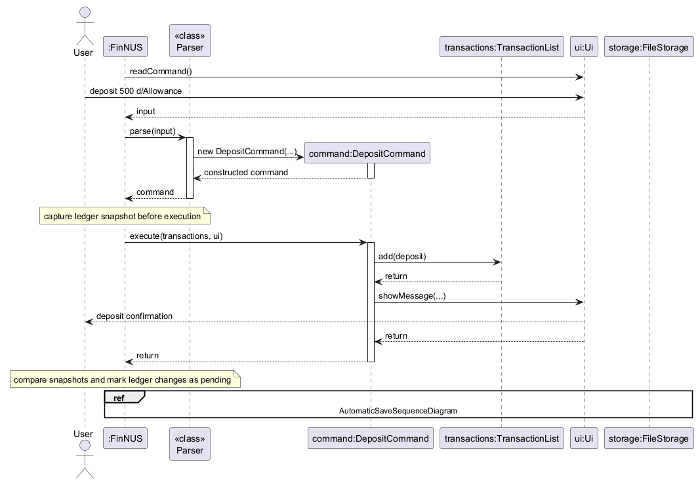

*Figure 2. A successful SGD deposit after setup. The reference frame expands into Figure 18's saving sequence.
Transaction construction and snapshot internals are omitted.
[PlantUML source](diagrams/CommandExecutionSequenceDiagram.puml).*

Blank input is ignored. If parsing or execution throws a `FinNusException`, the main loop displays its message through
`Ui#showError()` and continues accepting commands. Both `exit` and end of input trigger a final attempt to save pending
changes. If that attempt fails or saving is disabled, FinNUS warns that unsaved changes will be lost after exit.

### UI, parser, and commands

`CommandWord` defines names, descriptions, and usage strings shared by the parser and help output. Concrete commands
extend `Command` and implement `execute(TransactionList, Ui)`.

The class diagram shows how `DepositCommand` and `BalanceCommand` extend `Command` and use `TransactionList`.
`DepositCommand` represents commands that add transactions; `BalanceCommand` represents commands that read ledger state.
Other subclasses, private members, and parser and UI relationships are omitted.

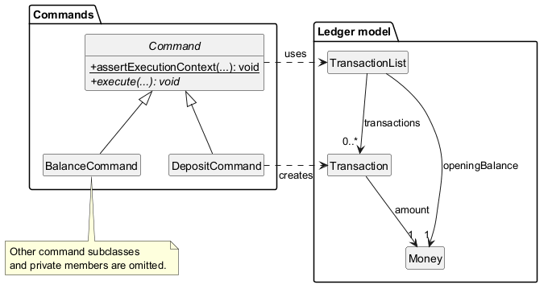

*Figure 3. Command and ledger model relationships. [PlantUML source](diagrams/CommandClassDiagram.puml).*

#### Parsing vs execution responsibilities

1. **Separation of concerns:** `Parser` is responsible solely for syntax validation, prefix extraction (`d/`, `c/`, `t/`), and format verification. It converts raw string tokens into validated values (such as `Money` or currency codes) and constructs concrete, immutable `Command` objects.
2. **Stateless command execution:** Commands encapsulate user intent but do not retain long-lived references to application state. Instead, `Command#execute(TransactionList, Ui)` receives the working `TransactionList` as an argument when executed by the main loop.
3. **Domain mutation example (`DepositCommand`):**
   - The user inputs `deposit 50 d/Allowance`.
   - `Parser#parseDeposit()` verifies that `50` is a valid positive monetary value at or below `Money.MAX_AMOUNT`, extracts the optional description, and constructs a `DepositCommand(amount, description)`.
   - When `DepositCommand#execute(transactions, ui)` runs, it creates a new immutable `Transaction(TransactionType.DEPOSIT, amount, description)` and invokes `transactions.add(transaction)`.
   - `TransactionList` inserts the new `Transaction` by date, retaining entry order for equal dates. The `Money` value object remains shared and immutable across calculations such as `TransactionList#getBalance()`.
<!-- @@author -->

<!-- @@author nkyjStar -->
### Representing money

`Money` is the shared value type for monetary amounts. The parser creates it from user input,
`Transaction` stores it, `TransactionList` uses it to calculate balances, and storage writes its
exact decimal value. Keeping these operations in one class prevents different commands from
making different choices about arithmetic and display. `Money` is a value object: two instances
represent the same amount when their numerical values are equal, even if they were constructed
from differently scaled decimals such as `10` and `10.00`.

#### Internal representation and operations

`Money` is `final`, holds a private final `BigDecimal`, and has a private constructor. Callers
create values through `Money.of(BigDecimal)`, `Money.of(String)`, or `Money.of(long)`. The factory
returns the shared `Money.ZERO` instance for any numerical zero; it creates a new `Money` for a
nonzero result. This means two references to zero need not identify two different objects.

The class diagram shows where monetary values are stored. Each `Transaction` has one `Money`
amount, each `TransactionList` has one `Money` opening balance and zero or more transactions, and
each `Money` wraps one `BigDecimal`. The associations show references rather than exclusive
ownership: an immutable `Money` instance may be shared. The diagram lists every `Money` method,
including its private constructor, but omits its private formatting constants and unrelated
members of `Transaction` and `TransactionList`.

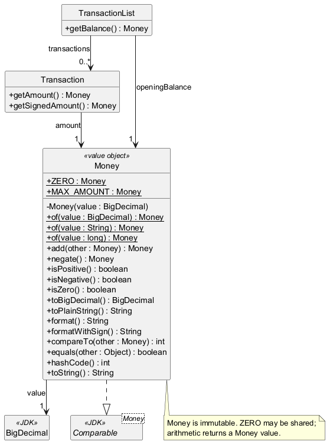

*Figure 4. Money's internal value and its references from transactions and the transaction list.
[PlantUML source](diagrams/MoneyClassDiagram.puml).*

Arithmetic does not change either operand. `add()` adds the wrapped `BigDecimal` values and
returns the result through `Money.of()`. `negate()` similarly returns the value with its sign
reversed. For example, if `first` represents `10.005` and `second` represents `0.10`,
`first.add(second)` gives a separate `Money` representing `10.105`, while `first` still represents
`10.005`. This matters when `TransactionList#getBalance()` repeatedly adds signed transaction
amounts: each step produces the next total instead of changing the opening balance or a
transaction's stored amount. A deposit's `Transaction#getSignedAmount()` returns its existing
`Money` object; a withdrawal calls `negate()` to obtain a negative value.

The following sequence shows an example usage of `Money`. It uses object names rather than one generic `Money` lifeline. The two
inputs and the nonzero sum are distinct objects:

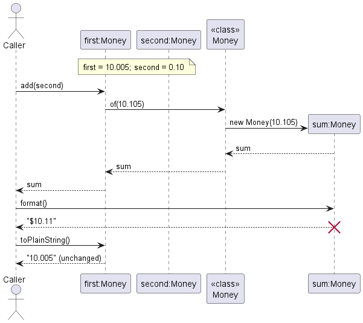

*Figure 5. Exact addition, display rounding, and preservation of the original monetary value.
[PlantUML source](diagrams/MoneySequenceDiagram.puml).*

`Money` does not require every value to be positive or below `Money.MAX_AMOUNT`.
`Parser#parseAmount()` enforces those rules for user-entered transaction amounts, while
`parseNonNegativeAmount()` permits zero for an opening balance. Keeping sign validation at the
input boundary allows `Money` to represent a withdrawal's negative effect and a negative
running balance. It also allows exact sub-cent values within the domain even though ordinary
user input is limited to two decimal places.

<!-- @@author chancheese -->
`Money.MAX_AMOUNT` (SGD 1,000,000) caps each amount a user enters. A foreign amount is checked after it is
converted to SGD, so a large amount in a currency such as JPY can still be valid. A student is unlikely to move
that much at once, so a larger value is treated as a typo.
<!-- @@author -->

#### Formatting and equality

Calculations retain every decimal place. `format()` rounds only the displayed value to two
places with `RoundingMode.HALF_UP`, giving `$10.11` for the sum in the diagram. It puts a minus
sign before the dollar sign for a negative displayed amount. If a small negative value rounds
to zero, it displays `$0.00` rather than `-$0.00`. `formatWithSign()` is used for transaction
lines, where deposits and withdrawals need explicit `+` and `-` signs. For a nonzero sub-cent
amount that would otherwise appear as zero, it preserves the exact digits, such as
`-$0.004`, so the transaction's direction remains visible.

`toPlainString()` and `toBigDecimal()` expose the unrounded value for storage and integration;
`toString()` also returns the plain decimal representation. Formatting is therefore a
presentation step, not a change to the stored amount. `equals()` uses `BigDecimal.compareTo()`
so `Money.of("10")` equals `Money.of("10.00")`. `hashCode()` removes trailing zeros first,
keeping equal values consistent in hash-based collections. `compareTo()` uses numerical order,
which lets the parser compare an amount with `Money.MAX_AMOUNT`.

#### Design considerations

`double` would make arithmetic shorter, but values such as `0.10` cannot generally be stored
exactly in binary floating point. A raw `BigDecimal` in every command would preserve precision,
but each command would have to repeat sign operations, rounding, and output rules. `Money`
centralizes those rules while still using `BigDecimal` for exact arithmetic. The tradeoff is an
extra class and method calls instead of operators; in return, the balance and transaction
display use the same monetary behaviour. `MoneyTest` checks exact repeated addition,
immutability after negation, rounding only for display, signed sub-cent output, and equality
across different decimal scales.
<!-- @@author -->

<!-- @@author naieel04 -->
### Storage

`Storage` defines the persistence interface. `FileStorage` handles files, while `LedgerCodec` converts between text
records and `LedgerSnapshot`. `LoadResult` carries recovered state, warnings, and whether saving is allowed.

- The main file is `finnus.txt`, beside the packaged JAR or in the working directory during development.
- The previous-state backup is `finnus.txt.bak`.
<!-- @@author lololol8484 -->
- The current text format starts with `FINNUS|1` and stores opening balance, rates, custom categories, transactions,
  allowance settings, and optional spending-alert thresholds.
<!-- @@author -->

<!-- @@author naieel04 -->

- Foreign-currency transactions also store their currency code, original amount, and the rate used. The stored SGD
  value is checked against those details during loading so later rate changes do not alter past transactions.
- Descriptions are Base64-encoded UTF-8 text. Base64 is an encoding, not encryption.
- Saving uses temporary files and atomic replacement; loading can recover valid rows or a clean backup.

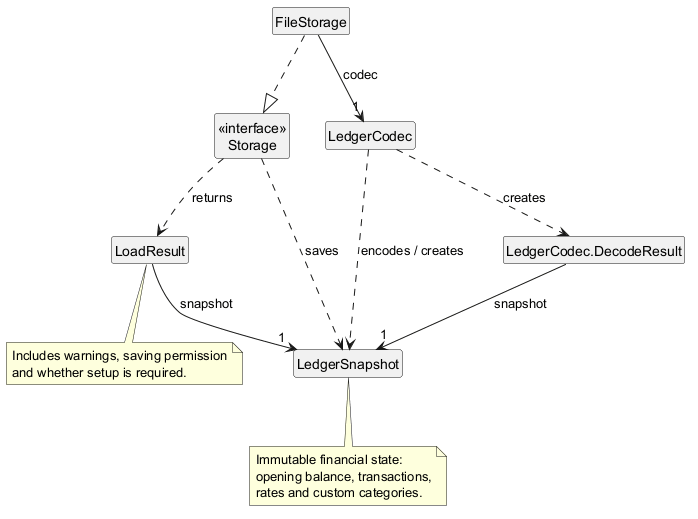

The storage diagram is intentionally a high-level view of the persistence components. `LedgerSnapshot` also carries
allowance settings and spending-alert settings, which are omitted from this simplified class diagram.

<!-- @@author -->

*Figure 6. Storage component structure and state transfer. [PlantUML source](diagrams/StorageClassDiagram.puml).*

<!-- @@author naieel04 -->

A complete save file can contain the following records:

```text
FINNUS|1
OPENING|100
RATE|JPY|110
CATEGORY|Meals
ALLOWANCE|5|500||2026-10-05
SPENDING_ALERT|100|90
TRANSACTION|DEPOSIT|50|QWxsb3dhbmNl||2026-10-20
TRANSACTION|WITHDRAWAL|10.00|UmFtZW4=|JPY|1100|110|Meals|2026-10-20
```

`OPENING` stores the starting SGD balance. `RATE` stores foreign-currency units per SGD, and `CATEGORY` declares a custom
category; predefined categories need no separate records. A `TRANSACTION` stores its type, SGD amount, Base64 description,
followed by category and date fields. The deposit's category field is empty; an unknown date is also empty.
The descriptions above decode to `Allowance` and `Ramen`.
Foreign transactions place their currency code, original amount, and recorded rate before the category field.

<!-- @@author -->

<!-- @@author lololol8484 -->
`SPENDING_ALERT|BALANCE_THRESHOLD|ALLOWANCE_PERCENTAGE` stores the optional alert settings. Either value may be empty
when the user skipped it. Files without this record load with both optional settings unset; malformed or duplicate alert
records are skipped with a warning.
<!-- @@author -->

<!-- @@author naieel04 -->

Current SGD transaction rows have six fields and foreign rows have nine, including the date after the category.
An empty date field represents an undated legacy entry. The decoder also accepts older five- and eight-field rows
with categories but no dates, and four- and seven-field rows without categories, assigning legacy withdrawals to
`Others`. It validates amounts, rates, descriptions,
and categories before restoring the ledger. Unsupported numbered format versions disable saving; malformed rows can be
skipped with warnings, as described in [Automatic saving and recovery](#automatic-saving-and-recovery).

<!-- @@author -->

<!-- @@author -->

---

<!-- @@author naieel04 -->

## Implementation

<!-- @@author -->

<!-- @@author nabijonzzz -->
### Adding a deposit or withdrawal

The `deposit` and `withdraw` commands record money coming in and going out. Each one creates a
`Transaction` and adds it to the `TransactionList`, which is the single place where all
transactions are stored and where the balance is calculated.

#### Classes involved

* `Parser` turns the text typed by the user into a command object, and rejects invalid input by
  throwing a `FinNusException`.
* `DepositCommand` and `WithdrawCommand` are subclasses of the abstract `Command` class. Each
  overrides `execute(TransactionList, Ui)`.
* `Transaction` is an immutable record of one money movement. It stores a `TransactionType`
  (`DEPOSIT` or `WITHDRAWAL`), a positive `Money` amount and a description.
<!-- @@author lololol8484 -->
* `TransactionList` keeps transactions chronologically by date, with undated legacy transactions first internally.
<!-- @@author nabijonzzz -->

#### How a withdrawal is processed

Given below is what happens when the user enters `withdraw 4.50 d/Lunch`.

1. `FinNUS#run()` reads the line through `Ui` and passes it to `Parser#parse()`.
2. `Parser#parse()` reads the command word `withdraw` and calls `parseWithdraw()` with the arguments `4.50 d/Lunch`
   and today's date.
3. `splitAmountAndDescription()` splits the arguments into the amount `"4.50"` and the
   description `"Lunch"`. The `d/` prefix only counts when it starts a word, so text such as
   `and/or` inside a description is not mistaken for a prefix. The amount and `d/DESCRIPTION`
   may be given in either order, e.g. `withdraw d/Lunch 4.50`.
4. `parseAmount()` checks the amount and converts it to a `Money` value. For a withdrawal,
   `parseWithdraw()` also checks that the description is not empty.
5. The parser returns a new `WithdrawCommand` with the amount, the description, no category name and today's date.
6. `FinNUS` calls `execute()`, which creates a `Transaction` of type `WITHDRAWAL`. If the withdrawal crosses a
   [spending alert](#spending-alerts) threshold, the user must confirm it first; a cancelled withdrawal is not added.
   Otherwise, the `Transaction` is added to the `TransactionList` and a confirmation is shown through `Ui`.

A deposit follows the same steps, except that the description is optional and no spending alert is checked.

<!-- @@author lololol8484 -->
Before extracting optional fields, `Parser` validates every supplied prefix value. A prefix followed by another
recognised prefix is rejected as a missing value, regardless of the order in which the fields were entered. This
prevents extraction of one field from hiding a malformed neighbouring field.
<!-- @@author nabijonzzz -->

#### Validation rules

An amount is accepted only if it:

* matches `\d+(\.\d{1,2})?`, i.e. a plain number with at most 2 decimal places. This one
  check rejects inputs such as `-5`, `1e3`, `NaN`, `$5` and `4.555`;
* is greater than 0;
* is not more than `Money.MAX_AMOUNT` (SGD 1,000,000), which catches typos such as extra zeros.

If any rule fails, the parser throws a `FinNusException`. The main loop catches it and shows the
message to the user, so invalid input never stops the app.

#### Design considerations

**Aspect: how amounts are stored**

* **Alternative 1 (current choice):** `Money`, which wraps a `BigDecimal`.
    * Pros: stores decimal amounts exactly, so the balance never drifts, and keeps formatting in one place.
    * Cons: more verbose, e.g. `a.add(b)` instead of `a + b`, and `compareTo()` instead of `<`.
* **Alternative 2:** `double`.
    * Pros: simpler arithmetic.
    * Cons: most decimal values cannot be stored exactly (e.g. `0.1 + 0.2` gives
      `0.30000000000000004`), so balances would become slightly wrong over many transactions.

**Aspect: whether a withdrawal needs a description**

* **Alternative 1 (current choice):** a description is required for `withdraw` but optional for
  `deposit`.
    * Pros: users always know what they spent money on, which is the main purpose of tracking
      expenses. Most deposits are regular allowances, so a description adds little.
    * Cons: a withdrawal takes slightly longer to type.
* **Alternative 2:** the description is optional for both.
    * Pros: faster to type.
    * Cons: the transaction history becomes hard to understand later.

<!-- @@author -->

<!-- @@author lololol8484 -->
### First-run setup

The opening balance is the money the user had before they started using FinNUS. The setup flow
collects and confirms this value once, before normal commands become available.

#### How it works

1. `FinNUS#restoreSession()` checks `LoadResult#setupRequired()`. `FileStorage` requires setup
   when there is no existing ledger or when it loads a `SETUP_PENDING` marker.
2. `FinNUS` runs `Setup#run()` before showing the normal welcome message. `Setup` prompts for an
   opening balance in SGD and parses it with `Parser#parseNonNegativeAmount()`, which permits
   zero. Invalid amounts show an error and return to the amount prompt.
3. `Setup` asks the user to confirm the amount with `yes` or `y`. Invalid confirmation answers
   repeat the confirmation prompt; `no` or `n` returns to the amount prompt.
4. The ledger is not changed while the user is entering or reviewing an amount. Only after
   confirmation does `Setup` execute `OpeningBalanceCommand`.
5. If input ends before confirmation, `Setup#run()` returns `false`. `FinNUS` stops startup
   without saving the unconfirmed amount. The pending marker remains, so setup is offered again
   on the next run. Immediately after confirmation, `Setup#run()` invokes the supplied callback and `FinNUS`
   attempts to save the opening balance before any optional prompts. After a successful save, later runs skip setup
   even if optional setup was interrupted. Failed saves remain pending and are retried.
6. After confirming the opening balance, setup asks for an optional balance threshold, then the
   allowance day and optional amount. If an amount is entered, setup asks for an optional whole
   percentage from 1 to 100. End of input or Enter skips these optional settings. The user can
   configure either setting later with `alert`.

The sequence diagram below shows this interaction flow.

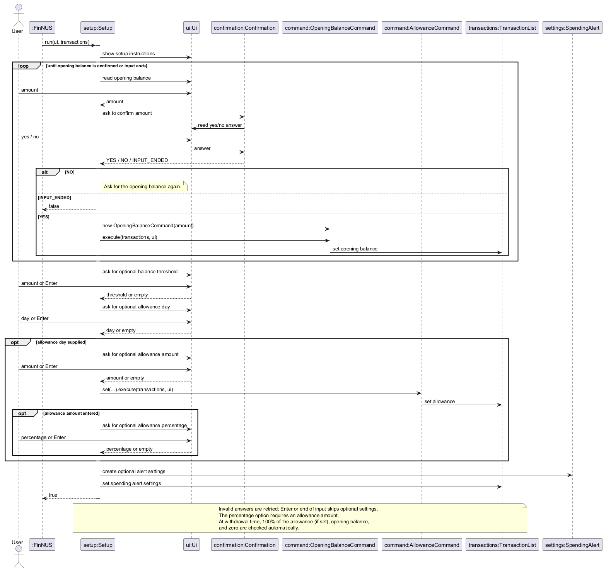

The diagram summarises the prompts; the persistence callback between balance confirmation and optional questions
is omitted. After optional setup completes, FinNUS saves any additional changes.

<!-- @@author lololol8484 -->
*Figure 7. First-run setup, including opening-balance confirmation and optional alert and allowance settings.
[PlantUML source](diagrams/SetupSequenceDiagram.puml).*
<!-- @@author -->

<!-- @@author chancheese -->
<!-- @@author lololol8484 -->
`Setup` asks for the optional balance threshold before the allowance prompts. The optional percentage prompt only
appears when an allowance amount was entered. See [Spending alerts](#spending-alerts).
<!-- @@author chancheese -->
After the threshold prompt, `Setup` asks for the allowance day and its SGD amount. Pressing Enter (or input ending)
skips either one, and setup still counts as complete. See
[Setting a monthly allowance](#setting-a-monthly-allowance).

`opening` is marked as setup-only in `CommandWord`, so typing it in the normal command loop is
treated as an unknown command.
<!-- @@author lololol8484 -->
`SetupTest` covers valid and invalid amounts, confirmation, re-entry, and input ending before
confirmation.
<!-- @@author -->

<!-- @@author lololol8484 -->
### Spending alerts

`SpendingAlert` stores the two optional settings and evaluates a proposed withdrawal before it is added. `WithdrawCommand`
and `ForeignTransactionCommand` both call `confirmWithdrawal()`, so SGD and converted foreign withdrawals use the same
rules. A declined confirmation or ended input returns before `TransactionList#add()`; only explicit `yes` or `y` lets the
command continue.

`EditCommand` calls `confirmEdit()` before replacing a withdrawal. The original withdrawal is accounted for in both
balance and cycle calculations, so only the replacement's net effect is tested. A date edit compares spending in
the destination cycle before and after replacement. Undated edits remain excluded from allowance-cycle totals,
but still undergo balance checks. A declined confirmation or ended input leaves the original entry unchanged.

`SpendingAlert#crossedBy()` compares the current ledger with the proposed result and returns every threshold crossed:

1. The optional fixed balance threshold, when configured.
2. The optional percentage of the allowance, when configured and an allowance amount exists.
3. The fixed 100% allowance amount, when an allowance amount exists.
4. The opening balance.
5. Zero.

The allowance thresholds sum dated withdrawals in the cycle containing the proposed transaction date. Older undated
transactions are excluded, matching `AllowanceCommand#summarise()`. The allowance amount is converted to SGD using its
configured currency rate when needed. Balance thresholds use the current calculated balance, including the proposed
withdrawal. Comparisons report a threshold only when the value moves from its safe side to beyond it; if the balance
later recovers and crosses again, a new alert is shown. A single withdrawal can cross several thresholds and produces
one confirmation listing them all. When the opening balance is zero, the opening-balance and zero conditions coincide
and both descriptions are included.

<!-- @@author lololol8484 -->
The following sequence focuses on the confirmation boundary: a withdrawal is added only after the user approves any
newly crossed thresholds.

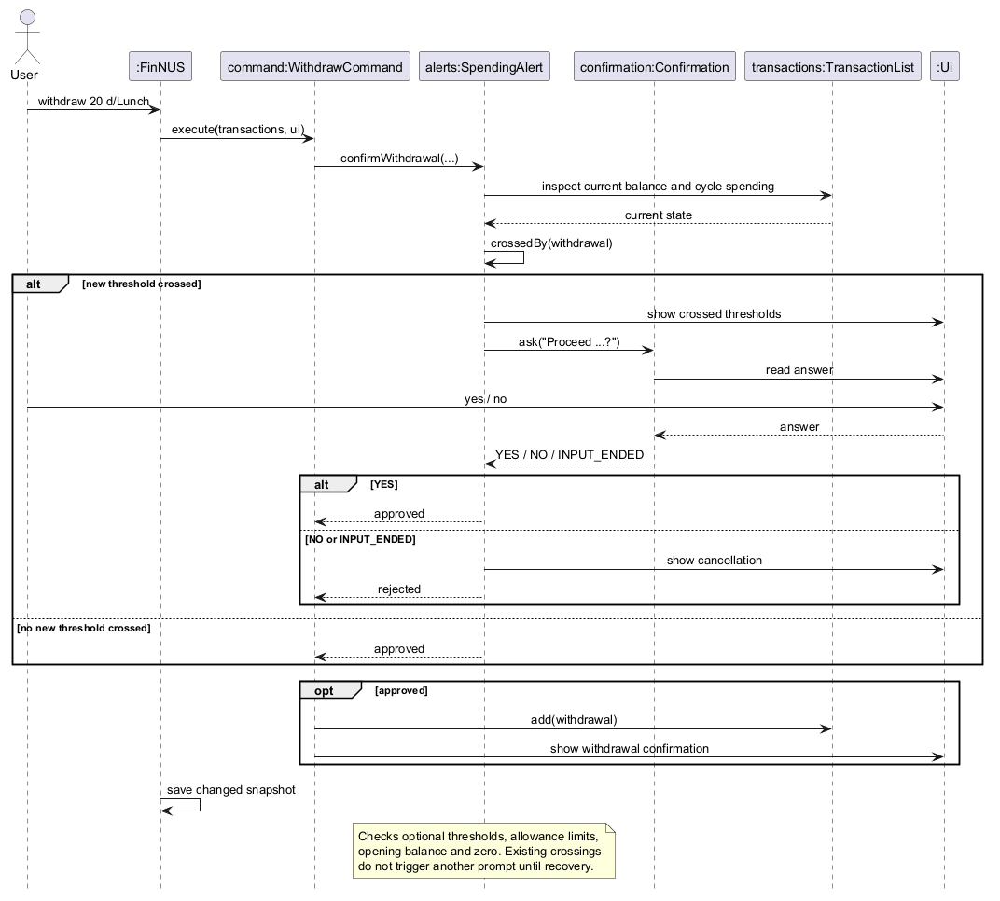

*Figure 8. Checking spending thresholds and confirming a proposed withdrawal.
[PlantUML source](diagrams/SpendingAlertSequenceDiagram.puml).*
<!-- @@author -->

`Confirmation#ask()` handles yes/no parsing and invalid-answer retries. It returns `YES`, `NO`, or `INPUT_ENDED`, leaving
each caller to decide what those results mean. Setup uses it for opening-balance confirmation; spending alerts use it
before recording a withdrawal.

`TransactionList` owns the settings, and `LedgerSnapshot` includes them in equality-based change detection. The codec
stores non-empty settings in `SPENDING_ALERT|BALANCE_THRESHOLD|ALLOWANCE_PERCENTAGE`; empty fields represent skipped
options. Older files without this row load with both options unset, and malformed or duplicate rows are reported and
skipped.

<!-- @@author lololol8484 -->
`AlertCommand` displays both optional settings with `alert`, sets or clears either setting, and preserves the other
setting during an update. `Parser#parseAlert()` supports `alert balance AMOUNT` or `alert balance off`, and
`alert allowance PERCENT` or `alert allowance off`. Balance amounts use `Parser#parseAmount()`; percentages must be
whole values from 1 to 100. The allowance percentage may be saved before an allowance amount is configured, and
`SpendingAlert` applies it when an allowance amount becomes available. `CommandWord` supplies the help syntax, which
`HelpCommand` builds from the registered commands. Since `LedgerSnapshot` already includes both values, command
updates use normal change detection and persistence. Tests cover parsing, display, set/clear behavior, preserving the
other setting, help output, and persistence across restart.
<!-- @@author -->

<!-- @@author chancheese -->
### Applying the confirmed opening balance

`OpeningBalanceCommand#execute()` stores the confirmed amount with
`TransactionList#setOpeningBalance()`.
<!-- @@author lololol8484 -->
This command was implemented separately from the setup flow.
<!-- @@author chancheese -->

The opening balance is a separate field in `TransactionList`, not a `Transaction`.
`getBalance()` uses it as the starting value when adding up all transactions, as shown in
[Viewing the current balance](#viewing-the-current-balance).

#### Design considerations

**Aspect: how the opening balance is stored**

* **Alternative 1 (current choice):** a separate field in `TransactionList`.
    * Pros: it never appears in `recent`, cannot be removed by `delete`, and is not counted as
      income.
    * Cons: storage has to save it separately from the transactions.
* **Alternative 2:** a special first `DEPOSIT` transaction.
    * Pros: no extra field.
    * Cons: it would look like real income in the history and could be deleted by accident.
<!-- @@author -->

<!-- @@author lololol8484 -->
### Deleting a transaction

The `delete INDEX` command removes a transaction using the one-based index shown by `recent`
and `find`. Index 1 refers to the newest transaction. The opening balance is not a transaction
and cannot be deleted.

#### How it works

1. `Parser#parse()` dispatches `delete` to `parseDelete()`. The parser requires a positive
   integer index and returns a `DeleteCommand`.
2. `DeleteCommand#execute()` checks that the index is within the transaction count. It converts
   the newest-first index to the ledger's zero-based, oldest-first index using
   `transactions.size() - index`.
3. `TransactionList#delete()` removes and returns the selected transaction. The command logs
   the deletion and displays the deleted transaction through `Ui`.
4. `FinNUS` compares ledger snapshots before and after command execution. If the ledger changed,
   it attempts to save the updated snapshot.

An invalid or out-of-range index raises `FinNusException`; the main loop displays the error and
continues without changing the ledger. `DeleteCommandTest` and `ParserTest` cover command
validation and deletion behavior.

<!-- @@author lololol8484 -->
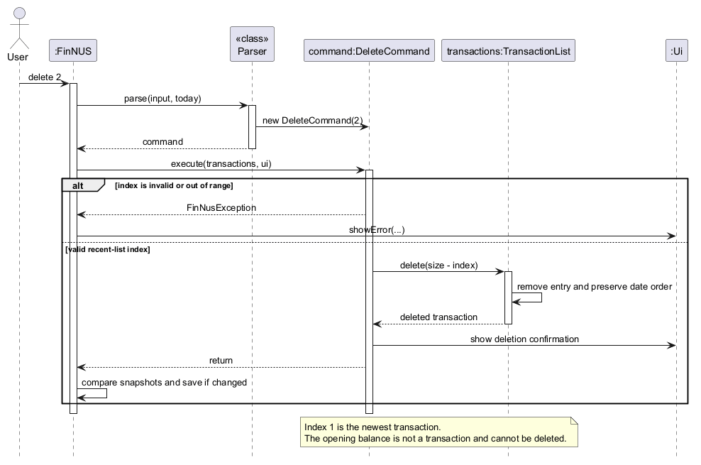

*Figure 9. Converting a newest-first display index before deleting a transaction.
[PlantUML source](diagrams/DeleteSequenceDiagram.puml).*
<!-- @@author -->

#### Design considerations

<!-- @@author lololol8484 -->
`TransactionList` stores dated transactions from oldest to newest and keeps undated legacy entries at the start.
Transactions entered on the same date retain their entry order internally. `recent` and `find` traverse the list in
reverse, so the newest date and most recently entered same-day transaction appear first. `delete` translates the
displayed index to the matching position in the sorted list. A backdated addition may shift the indices of other
transactions; users should check the current `recent` or `find` output before deleting.
<!-- @@author -->

<!-- @@author naieel04 -->

### Editing a transaction

The `edit INDEX` command corrects selected fields of a deposit or withdrawal using the number shown by
`recent`, `history` or `find`. See the [User Guide](UserGuide.md#editing-a-transaction-edit) for syntax and examples.

#### How it works

1. `Parser#parse()` delegates to `EditParser#parse()`, which validates the index and field syntax, then creates an
   `EditCommand` containing immutable `EditFields`. Null fields mean "keep the old value"; empty `d/` means clear it.
2. `EditCommand#execute()` checks the index and reads the entry at `transactions.size() - index`. It retains omitted
   values and validates the complete replacement before changing the ledger. Invalid edits raise `FinNusException`.
3. A changed withdrawal is checked with `SpendingAlert#confirmEdit()` before mutation. If a threshold is newly crossed,
   confirmation is required; declining or ending input leaves the entry unchanged. After approval, or if no alert
   applies, `TransactionList#replace()` replaces the entry and applies a stable date sort without changing the count.
   Date edits can change displayed indices; other edits retain the entry's position.
4. The command displays the before/after entries and any saved FX rate. FinNUS detects the changed snapshot and
   attempts to save it using the existing storage format. Failed saves remain pending for retry.

This sequence shows a successful `edit 1 a/6.50` on an SGD withdrawal:

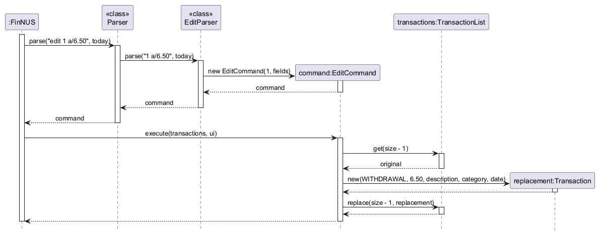

*Figure 10. A successful SGD edit that crosses no new alert threshold. Validation details, spending-alert confirmation,
UI output, allowance handling and saving are omitted.
[PlantUML source](diagrams/EditSequenceDiagram.puml).*

Foreign amount edits retain the saved rate unless `r/` is supplied. `ForeignAmount#toSgd()` rounds half-up to cents;
the command checks the SGD limit without using or changing global rates. Metadata-only edits retain the foreign value.
Identical values print `No changes made.` without replacement; decimal scale alone does not count as a change.

`FinNUS#prepareAllowance()` defers allowance crediting until after an edit consumes its index. Editing an allowance
deposit leaves its schedule and `lastCredited` unchanged. History mode requires `stop` before editing.

<!-- @@author -->

#### Design considerations

<!-- @@author naieel04 -->

Immutable replacement avoids partial updates and preserves transaction type and currency. Mutable setters would need
rollback on validation failure; deletion and re-entry would change the position of same-day transactions.

Parser, command and replacement tests cover validation, retained fields, FX rounding, balances and ordering.
`FinNUSTest` and `EditPersistenceTest` cover allowance timing, save retries, reports and restart persistence.

<!-- @@author -->

### Setting exchange rates

The `rate` command stores exchange rates used to convert foreign-currency transactions
to SGD. `rate JPY 110` sets 1 SGD = 110 JPY, and `rate` on its own lists all rates.

#### How it works

1. `Parser#parseRate()` expects exactly two arguments, a currency code and a rate.
2. `parseCurrencyCode()` upper-cases the code and checks it with `java.util.Currency`, which
   rejects typos such as `JYP` without FinNUS keeping its own list. `SGD` is rejected because
   amounts are already in SGD.
3. `parseRateValue()` accepts a positive number with up to 6 decimal places (e.g. `0.5425`), up to
   `Parser.MAX_RATE`.
4. `RateCommand#execute()` gets the `CurrencyRates` from `TransactionList#getRates()` and calls
   `setRate()`. If the currency already had a rate, the old one is shown too.

`CurrencyRates` keeps the rates in a `TreeMap`, so `rate` lists them in alphabetical order.

#### Design considerations

**Aspect: where exchange rates come from**

* **Alternative 1 (current choice):** the user types each rate in.
    * Pros: works offline and gives the same result every time, which makes it easy to test.
    * Cons: rates have to be updated by hand.
* **Alternative 2:** fetch live rates from an online API.
    * Pros: always up to date.
    * Cons: needs internet access, and tests would give different results from day to day.

<!-- @@author -->

<!-- @@author nkyjStar -->
### Viewing recent transactions

The `recent [NUMBER]` command lets a user inspect the latest recorded activity without changing
the ledger. With no number, it shows up to five transactions; `recent 2` shows up to two. The
numbered result is also useful when choosing an index for `delete`, which uses the same
newest-first ordering. The opening balance is not a transaction, so it never appears here.

#### How it works

`FinNUS#run()` reads a line and passes it to `executeCommand()`, which calls `Parser#parse()`. For `recent`, the parser calls
`parseRecent()`. Blank arguments create a `RecentTransactionCommand` with a default length of five.
Otherwise, the parser converts the argument to an `int` and rejects a malformed or non-positive
length with `FinNusException`. The main loop shows that exception as an error and continues.

The command's `execute()` method requests the selected entries from
`TransactionList#getRecentTransactions(length)`. `TransactionList` stores dated entries oldest first, with undated
legacy entries before them, and inserts each new entry at its date-sorted position. It takes the last `length`
entries and returns them in reverse order. This handles a request longer than the ledger without a separate error
case. If the ledger is empty, it returns an empty list before attempting a sublist.

The command then numbers the returned entries starting at 1 and uses `Transaction#toString()`
for each line. The heading reports how many entries were actually returned, which can be less
than the requested length. `Ui#showMessage()` prints the heading and lines between dividers.
For an empty ledger, the command instead displays `Your list of transactions is currently empty.`

This sequence shows the normal path for `recent 2`:

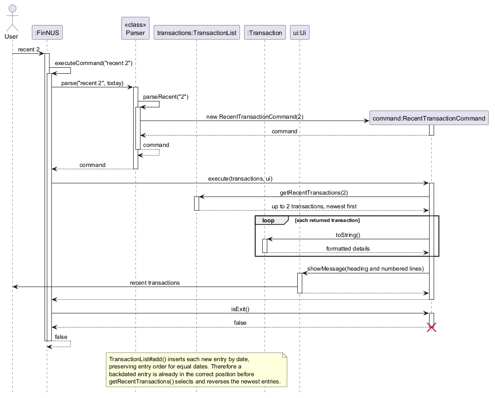

*Figure 11. Retrieving and displaying up to two recent transactions.
[PlantUML source](diagrams/RecentSequenceDiagram.puml).*

An X represents an object that is no longer referenced and can be garbage-collected. It does not represent an explicit
Java deletion or guarantee immediate collection.

For example, if TransactionList contains a deposit followed by a withdrawal, `recent 2` prints the
withdrawal as `1.` and the deposit as `2.`. The displayed numbers are positions in the current
newest-first result, not permanent transaction IDs. Adding or deleting an entry can change them.

#### Design considerations

<!-- @@author lololol8484 -->
Keeping the TransactionList in date order makes backdated entries appear in their chronological position and ensures
`recent`, `find`, and `delete` use the same ordering. Same-date transactions retain their entry order internally,
while the reversed view shows the newest entry first. `getRecentTransactions()` returns a read-only view, and the
command only formats data; it does not add, remove or change transactions.
<!-- @@author nkyjStar -->

<!-- @@author -->
<!-- @@author nkyjStar -->
### Viewing paginated transaction history

`history [n/NUMBER] [p/PAGE]` opens a newest-first view of all recorded transactions. The parser
accepts the two optional fields in either order, rejects duplicates, and creates a `HistoryCommand`.
Both fields use `HistoryCommand#parsePositiveNumber()`: malformed or non-positive text is rejected
as invalid, while a positive number above `Integer.MAX_VALUE` is reported as out of range. Its
defaults are five transactions per page and page 1. A page size larger than the transaction
count is valid; page 1 then displays all available entries. `HistoryCommand#execute()` checks that the
requested page exists before the application enters history mode, so an invalid initial page
leaves normal commands available.

`FinNUS` retains the active `HistoryCommand` in `historyView`. While it is active, the main loop
sends every non-blank line to `HistoryCommand#handleInput()` rather than the normal parser. That
method switches on `next`, `prev`, and `stop`, then checks the `p/` and `n/` prefixes. All other
commands, including `exit`, produce a mode-specific error. `stop` clears `historyView`. History
navigation does not modify `TransactionList`, but the loop still retries any pending save after a
successful input. The command logs successful navigation at `FINE`. Internal state assumptions
use assertions, while invalid user input produces `FinNusException`.

History controls only read transactions and update the viewing position; they create no new
transaction changes to save. This keeps the displayed indices stable during navigation. The saved
transaction list can still change if the application retries a save that failed before the view.
Opening `history` also runs the normal automatic allowance check, which may add a due deposit.

The sequence diagram follows a successful `history n/2 p/2`, `next`, and `stop` session:

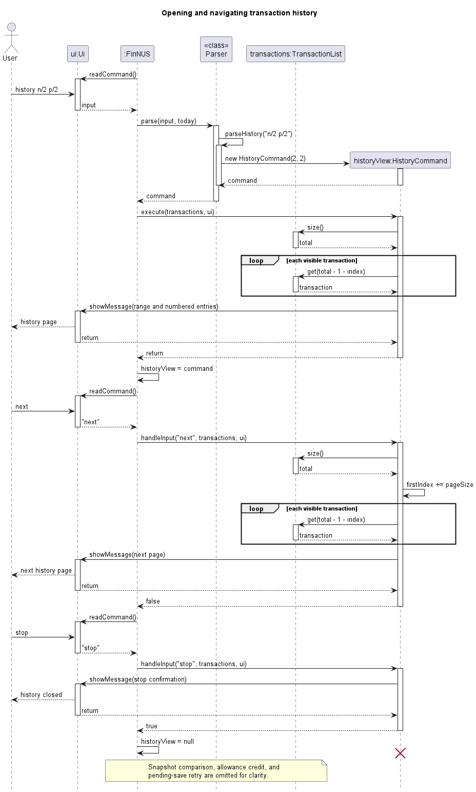

*Figure 12. Opening, navigating, and leaving history mode. Snapshot comparison and automatic
allowance handling are omitted. [PlantUML source](diagrams/HistorySequenceDiagram.puml).*

The command stores a zero-based `firstIndex` in newest-first order and a `pageSize`. It reads
transactions from `TransactionList` using `size - 1 - index`, leaving the stored chronological order
untouched. Displayed transaction numbers are global newest-first indices, so they agree with
`recent` and `delete`. The heading shows the visible range and total count instead of a page
number because `n/NUMBER` preserves the first visible transaction even when that position is
not aligned to a page boundary. `next` and `prev` move by the new page size from that position;
`p/PAGE` returns to boundaries counted from the newest transaction. Out-of-range navigation
keeps the current position. With no recorded transactions, page 1 shows an empty-list message
and `stop` remains available.

The class diagram shows the session reference and how history reads `TransactionList` for display:

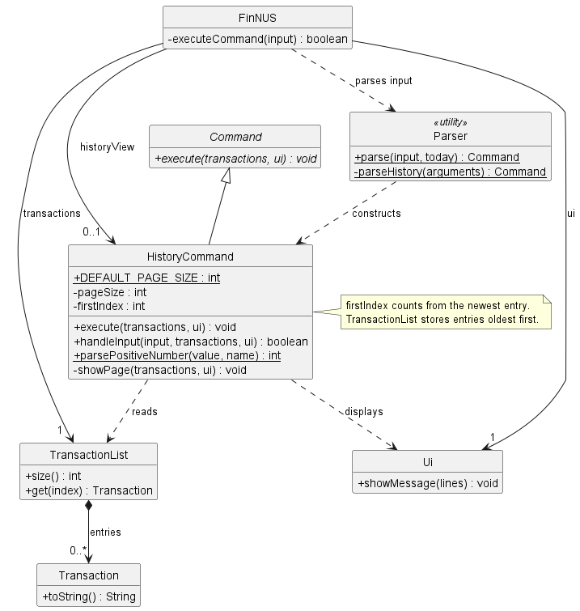

*Figure 13. History command state and its application, parser, transaction list, and UI
relationships.
[PlantUML source](diagrams/HistoryClassDiagram.puml).*

The multiplicities describe an active session: `FinNUS` has one `Ui`, one `TransactionList`,
and at most one active `HistoryCommand`. A `TransactionList` holds zero or more transactions.
Dashed dependencies represent method calls or construction, so they have no multiplicity.

`HistoryCommandTest`, `ParserTest`, and `FinNUSTest` cover page ordering, number consistency,
resizing, invalid input, empty history, and the command restriction in the application loop.

#### Design considerations

**Aspect: how to present the full history**

* **Alternative 1 (current choice):** show a page at a time, with a configurable page size and
  navigation commands.
  * Pros: each response stays readable as the transaction list grows, while every entry remains
    reachable. The user can choose how much to see at once.
  * Cons: reviewing distant entries takes more commands, and the command must keep track of the
    current position.
* **Alternative 2:** print the entire history in one response.
  * Pros: simple to implement and easy to scan when there are few entries.
  * Cons: a long history can flood the terminal and make a particular entry hard to find.

**Aspect: which commands are available while viewing history**

* **Alternative 1 (current choice):** accept only history controls until `stop`.
  * Pros: inputs have one meaning in this mode, and the displayed positions remain stable because
    transactions cannot be added or deleted during navigation.
  * Cons: the user must leave the view even to run a read-only command such as `recent` or `balance`.
* **Alternative 2:** allow normal commands alongside history controls.
  * Pros: the user could check a balance or recent activity without leaving the view.
  * Cons: command dispatch becomes more complex. A command that changes the transaction list could
    shift the current page and its displayed indices, so the view would need a rule for refreshing
    or resetting its position. Allowing only read-only commands would avoid that shift but still
    require a separate rule for which normal commands are permitted.

**Aspect: transaction display order**

* **Alternative 1 (current choice):** display newest first, as `recent` does, while keeping
`TransactionList` in chronological order, with stable entry order for equal dates.
  * Pros: recent activity appears first. The global displayed indices match `recent` and `delete`,
    and adding a transaction remains a simple append to the stored list.
  * Cons: the displayed order differs from storage order, so history translates each displayed
    position to a list index.
* **Alternative 2:** display oldest first, matching storage order.
  * Pros: follows the chronology of transactions and needs no reverse index lookup.
  * Cons: a user must navigate toward the end to see recent activity, and the displayed indices
    would differ from those used by `recent` and `delete`.

**Aspect: what happens when the page size changes**

* **Alternative 1 (current choice):** keep the first visible transaction at the top after `n/NUMBER`.
  * Pros: the user keeps their place while adjusting how many entries are visible.
  * Cons: the new view may start between page boundaries, so the heading shows a transaction range
    rather than a page number; `p/PAGE` returns to boundaries for the new size.
* **Alternative 2:** return to the first page after changing the size.
  * Pros: page numbering stays straightforward.
  * Cons: the user loses their place and may need to navigate back to the same transaction.

<!-- @@author -->
<!-- @@author nabijonzzz -->
### Finding transactions

`find KEYWORD` lists the transactions whose description contains `KEYWORD`, ignoring case.
<!-- @@author -->

<!-- @@author chancheese -->
`find t/CATEGORY` lists the withdrawals in one category, and `find KEYWORD t/CATEGORY` combines both.

The parser first removes an optional `t/CATEGORY` with `Parser#extractCategory()`, the same method `withdraw`
uses, so category names follow the same rules and give the same errors. The rest is the keyword, so
`find chicken rice` still searches for the whole phrase. The parser returns a `FindCommand` with the keyword, the
category name, or both. If both are missing, it throws a `FinNusException`.
<!-- @@author -->

<!-- @@author nabijonzzz -->

`FindCommand#execute()` goes through the `TransactionList` from the newest transaction to the oldest, and keeps the
ones whose description contains the keyword. Each result is numbered with the same index that `recent` shows and
`delete` expects.
<!-- @@author lololol8484 -->
For a transaction at position `i` in the list (undated legacy entries first, then dated entries oldest first), its
index is `size - i`. For example, with 4 dated transactions, the newest one (position 3) has index 1:
<!-- @@author nabijonzzz -->

```
find lunch
1. [30 Oct 2026] [Withdrawal] -$12.00 (Lunch with friends) #Food    <- position 3, index 4 - 3 = 1
3. [28 Oct 2026] [Withdrawal] -$4.50 (Lunch) #Food                  <- position 1, index 4 - 1 = 3
```

The command only reads the list, so searching never changes any transaction.
<!-- @@author -->

<!-- @@author chancheese -->
With a category, `execute()` first resolves the name through `CategoryList#resolve()`, as `WithdrawCommand` does. This
turns `food` into `Food`, and rejects a category that does not exist. A transaction then matches only if it meets
every criterion given. Deposits have no category, so they never match a category search.

Below the results, `FindCommand` shows `Received:` and `Spent:` totals, worded as in the `allowance` summary. Both
commands count with the same small `TransactionTotal` class, which adds up the SGD amounts with `Money#add()` and
counts the transactions. Foreign transactions count at the SGD value stored when they were recorded. A category
search leaves out the `Received:` line, because it can never include a deposit.
<!-- @@author -->

<!-- @@author nabijonzzz -->

#### Design considerations

**Aspect: how results are numbered**

* **Alternative 1 (current choice):** use the same index as `recent`.
  * Pros: the user can run `delete 3` straight after `find`, without looking the transaction up again.
  * Cons: the numbers are not consecutive (e.g. 1 and 3), which may look odd at first.
* **Alternative 2:** number the results 1, 2, 3, ...
  * Pros: looks neater.
  * Cons: these numbers would not work with `delete`, which could make the user delete the wrong transaction.

**Aspect: what is searched**

* **Alternative 1 (current choice):** the description, plus the category when `t/CATEGORY` is given.
  * Pros: simple and predictable; a keyword such as `5` will not match every amount containing a 5.
  * Cons: cannot search by amount.
* **Alternative 2:** the whole displayed text of each transaction.
  * Pros: one search covers description, amount and category.
  * Cons: many unexpected matches, e.g. `food` would match every `#Food` withdrawal.
<!-- @@author -->

<!-- @@author chancheese -->
**Aspect: where the category filter goes**

* **Alternative 1 (current choice):** a `t/CATEGORY` option on `find`.
  * Pros: reuses the `t/` prefix users already know from `withdraw`, and keeps the `recent` numbering that `delete`
    uses. No new command to learn.
  * Cons: `find` now has two optional parts, so the parser must reject a search with neither.
* **Alternative 2:** a new command such as `category food`.
  * Pros: a short command.
  * Cons: `category NAME` already adds a category, so the same words would mean two different things.
<!-- @@author -->

### Viewing the current balance

The `balance` command displays the current balance in SGD, including the opening balance and every
recorded deposit and withdrawal. It takes no required arguments; the current parser ignores
extra text after `balance`. Like `recent`, this command reads the ledger without changing it.

#### How it works

`Parser#parse()` creates a `BalanceCommand`. Its `execute()` method calls
`TransactionList#getBalance()` and passes the formatted result to `Ui#showMessage()`.
`TransactionList` is the single place that calculates the balance. It starts with
`openingBalance`, which defaults to `Money.ZERO`, then folds every transaction's signed amount
into that starting value:

```java
return transactions.stream()
        .map(Transaction::getSignedAmount)
        .reduce(openingBalance, Money::add);
```

`Transaction#getSignedAmount()` returns the positive amount for a deposit and its negation for
a withdrawal. For example, an opening balance of `$100.00`, a `$30.50` deposit and a `$4.50`
withdrawal give `$126.00`. With no transactions, the result is simply the opening balance.
Because the sum is recalculated whenever `balance` is invoked, deleting a transaction or changing the
opening balance is reflected in the next `balance` result.

`Money` wraps `BigDecimal`, so addition keeps decimal values exact. `Money#format()` rounds only
the displayed result to two decimal places using `HALF_UP` and adds the dollar sign. Thus, the
calculation retains precision if a stored amount has more than two decimal places. Such amounts
are covered by the balance command tests, even though ordinary user input is limited to cents.
Negative balances are allowed and displayed with a minus sign when their rounded value is
nonzero.

<!-- @@author chancheese -->
The balance itself has no upper limit, because `BigDecimal` has no fixed size. Only each entered
amount is capped (see [Representing money](#representing-money)).
<!-- @@author -->

The sequence below follows the calculation and display of one `balance` request:

<!-- @@author naieel04 -->

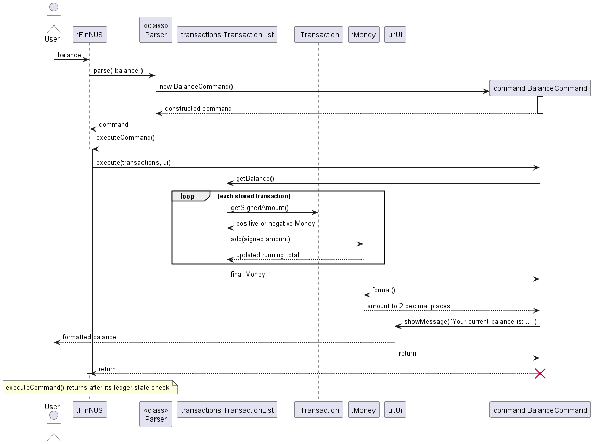

*Figure 14. Calculating and displaying the current balance.
[PlantUML source](diagrams/BalanceSequenceDiagram.puml).*

An X represents an object that is no longer referenced and can be garbage-collected. It does not represent an explicit
Java deletion or guarantee immediate collection.

<!-- @@author -->

#### Design considerations

Recalculating the balance on demand takes time proportional to the number of transactions, but
keeps one source of truth. A cached running balance would make reads faster, yet every deposit,
withdrawal, deletion and opening-balance update would have to maintain the cache correctly.
For this small ledger, the simpler calculation avoids that coordination. Both `recent` and
`balance` leave the ledger unchanged, so neither creates a new change to save. The application
may still retry a save that failed after an earlier command.
<!-- @@author -->

<!-- @@author chancheese -->
### Recording transactions in foreign currencies

Adding `c/CURRENCY` to `deposit` or `withdraw` (e.g. `withdraw 1100 d/Ramen c/JPY`) records an
amount typed in another currency. It is converted to SGD with the rate set by `rate`, and the
original amount is kept so it can be shown later, e.g. `[30 Oct 2026] [Withdrawal] -$10.00 (Ramen) [JPY 1100] #Others`.

#### How it works

The sequence diagram below shows what happens when the user enters `withdraw 1100 d/Ramen c/JPY`.
Logging, console output, input validation, spending-alert confirmation and saving the ledger afterwards are left out.

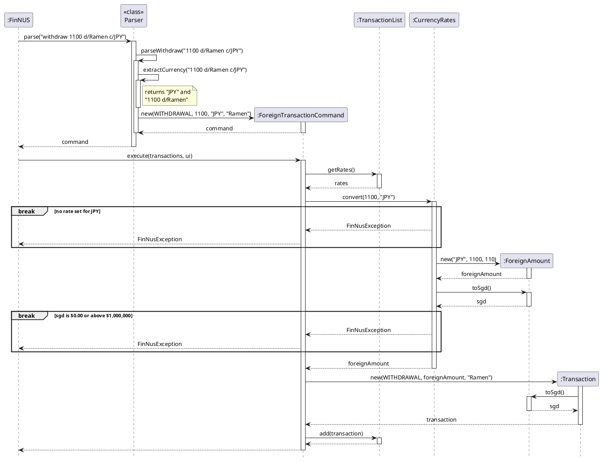

*Figure 15. Recording a JPY withdrawal, assuming a configured rate of 1 SGD = 110 JPY.
[PlantUML source](diagrams/ForeignTransactionSequenceDiagram.puml).*

1. `Parser#extractCurrency()` removes the `c/CURRENCY` part from the arguments, so the rest is
   split into amount and description exactly as before. `c/SGD` counts as no currency.
2. If a currency was given, `parseForeignAmount()` checks the amount and the parser returns a
   `ForeignTransactionCommand` instead of a `DepositCommand` or `WithdrawCommand`.
3. `ForeignTransactionCommand#execute()` calls `CurrencyRates#convert()`, which throws a
   `FinNusException` if no rate is set for the currency.
4. Otherwise, `convert()` creates a `ForeignAmount`, a record of the currency code, the amount as
   typed and the rate used, and calls its `toSgd()`, which divides the amount by the rate and
   rounds it to the nearest cent. If the result is $0.00 or above `Money.MAX_AMOUNT`
   (SGD 1,000,000), `convert()` throws a `FinNusException`; otherwise it returns the `ForeignAmount`.
5. The command creates a `Transaction` from the `ForeignAmount`. Its `amount` is the SGD value, so
   the balance, `recent` and `delete` work without any changes.

In the save file, a foreign transaction includes the currency code, the amount as typed, and the
rate before its final category field, e.g. `TRANSACTION|WITHDRAWAL|10.00|UmFtZW4=|JPY|1100|110|Others`.
Both SGD and foreign rows now include the category field; older rows without it still load.
When loading, a row whose SGD amount does not match its original amount and rate is skipped
because the record is inconsistent.

#### Design considerations

**Aspect: when the amount is converted**

* **Alternative 1 (current choice):** once, when the transaction is added, and the rate used is
  saved with it.
    * Pros: changing a rate later never changes past transactions or the balance.
    * Cons: each foreign transaction saves three extra values in the save file: the currency code,
      the original amount and the rate.
* **Alternative 2:** every time the balance is calculated, using the current rate.
    * Pros: nothing extra to store.
    * Cons: setting a new rate would silently change past spending and the balance.

**Aspect: which command handles foreign amounts**

* **Alternative 1 (current choice):** a separate `ForeignTransactionCommand`.
    * Pros: the rates are in `TransactionList`, which only a command can reach when it runs, so
      conversion and its errors stay in one place. `DepositCommand` and `WithdrawCommand` are
      unchanged.
    * Cons: one more class, and the confirmation message is built in two places.
* **Alternative 2:** add an optional currency to `DepositCommand` and `WithdrawCommand`.
    * Pros: fewer classes.
    * Cons: both commands would need the same conversion code, and their `execute()` would start
      throwing an exception that every existing caller has to handle.

**Aspect: rounding the converted amount**

`Money` keeps sub-cent values exact, but `toSgd()` rounds each conversion to the cent.

* **Alternative 1 (current choice):** round to the cent when converting.
    * Pros: the SGD value matches what a bank would record, and the original amount and rate are
      saved with it, so nothing is lost.
    * Cons: small rounding differences can add up across many foreign transactions.
* **Alternative 2:** keep the exact quotient, e.g. 1000 JPY at 110 is $9.0909...
    * Pros: no rounding at all.
    * Cons: some quotients never end, so they must be cut off somewhere anyway, and the balance
      would hold fractions of a cent that no real account has.
<!-- @@author -->

<!-- @@author nabijonzzz -->
### Categorising spending

Every withdrawal belongs to exactly one category, given with the optional `t/CATEGORY` (e.g. `withdraw 4.50 d/Lunch t/food`).
Without `t/CATEGORY`, the withdrawal is recorded under `Others`.
Users can add their own categories with `category NAME` and list all categories with `category`. A name may be `add` or
`list`; these are treated as category names, not subcommands.
<!-- @@author nabijonzzz -->

#### Classes involved

* `CategoryList` stores the predefined categories (`Food`, `Transport`, ..., `Others`) and the custom ones. It finds
  a category ignoring case, and returns it in the spelling it was created with.
* `TransactionList` owns the `CategoryList`, in the same way it owns `CurrencyRates`.
* `Transaction` has a `category` field: the category name for a withdrawal, and `null` for a deposit.
<!-- @@author lololol8484 -->
* `CategoryCommand` handles both `category NAME` and `category`.
<!-- @@author nabijonzzz -->

The class diagram below shows how these classes are related. Only the members relevant to categories are shown.

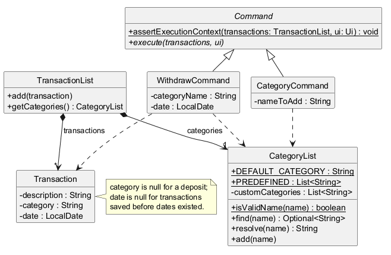

*Figure 16. Classes involved in categorising spending. [PlantUML source](diagrams/CategoryClassDiagram.puml).*

`TransactionList` owns exactly one `CategoryList`. `WithdrawCommand` and `CategoryCommand` do not keep a reference to
it; they get it from the `TransactionList` they are given when they run, which is why the existence of a category
is only checked at that point.

#### How a categorised withdrawal is processed

Given below is what happens when the user enters `withdraw 4.50 d/Lunch t/FOOD`.

1. `Parser#parseWithdraw()` calls `extractCategory()`, which removes `t/FOOD` from the arguments and checks that
   `FOOD` has a valid format (one word of letters, digits and `-`, at most 20 characters).
2. The rest of the arguments (`4.50 d/Lunch`) are parsed as before, and the parser returns a `WithdrawCommand` with
   the category name `FOOD`.
3. `WithdrawCommand#execute()` calls `CategoryList#resolve("FOOD")`, which returns `Food`. If the category did not
   exist, `resolve()` would throw a `FinNusException` listing the valid categories.
4. A `Transaction` with category `Food` is created and, after any spending alert confirmation, added to the
   `TransactionList` and shown as `[30 Oct 2026] [Withdrawal] -$4.50 (Lunch) #Food`.

The sequence diagram in [How a dated withdrawal is processed](#how-a-dated-withdrawal-is-processed) shows these
steps for a withdrawal that also has a date.

`c/` (currency), `t/` and `on/` (date) are all one-word values that can appear anywhere in the command. To avoid
several copies of the same logic, they are removed by one helper, `Parser#extractPrefixedValue()`, which also rejects a prefix that is
given twice or has no value.

#### Saving categories

Custom categories are saved as `CATEGORY|NAME` records. The category of a transaction is saved as one extra, last
field of its `TRANSACTION` record before the date (empty for a deposit), e.g.
`TRANSACTION|WITHDRAWAL|4.50|THVuY2g=|Food|2026-10-20`.

* Rows saved before categories existed have no category field. Their withdrawals are loaded under `Others`, so old
  save files keep working.
* A withdrawal whose category does not exist is loaded under `Others` with a warning, instead of being skipped,
  so the spending itself is never lost.
* Categories are resolved only after the whole file has been read, because a hand-edited file may list a
  `CATEGORY` record after the transactions that use it.

#### Design considerations

**Aspect: when to check that a category exists**

* **Alternative 1 (current choice):** the parser only checks the format of the name, and the command checks that
  the category exists when it runs.
  * Pros: custom categories live in the `TransactionList`, which the parser cannot see. This is the same approach
    used for currency rates in `ForeignTransactionCommand`.
  * Cons: a command with an unknown category is created and only fails when it runs.
* **Alternative 2:** pass the `CategoryList` to the parser.
  * Pros: all input errors are found in one place.
  * Cons: the parser would depend on the application's data, so it could no longer be a simple, stateless class.

**Aspect: how to handle unknown categories**

<!-- @@author lololol8484 -->
* **Alternative 1 (current choice):** reject them, and require `category NAME` to create a new one.
<!-- @@author nabijonzzz -->
  * Pros: a typo such as `t/fod` cannot silently create a new category and split the user's spending.
  * Cons: using a new category takes one extra command.
* **Alternative 2:** create a new category automatically.
  * Pros: faster for the user.
  * Cons: typos create unwanted categories that the user cannot remove.
<!-- @@author -->

<!-- @@author nabijonzzz -->
### Recording transaction dates

Every `Transaction` has a `LocalDate date`, given with `on/DATE` (e.g. `withdraw 4.50 d/Lunch on/2026-10-20`) or
set to today by default. It is shown first, e.g. `[20 Oct 2026] [Withdrawal] -$4.50 (Lunch) #Others`. Dates are
the basis for features that look at spending over a period, such as a budget cycle.

#### How a dated withdrawal is processed

1. `FinNUS` captures today's date from its injected `Clock` and passes it to `Parser#parse(input, today)`.
   The convenience overload `Parser#parse(input)` uses `LocalDate.now()`; tests can pass a fixed date.
2. `Parser#extractDate()` removes `on/2026-10-20` with the same `extractPrefixedValue()` helper used for `c/` and
   `t/`, and checks the date. `LocalDate.parse()` uses the strict ISO format, so it rejects both badly formatted
   text (`2026-2-3`) and dates that do not exist (`2026-02-30`). Before that, the text must match
   `\d{4}-\d{2}-\d{2}` exactly, because `LocalDate.parse()` alone also accepts signed years such as
   `-2026-01-01`. Dates before `Parser.EARLIEST_DATE` (2000-01-01) or after `today` are rejected too.
3. If no `on/` is given, `today` is used.
4. The date is passed through `WithdrawCommand` (or `DepositCommand` / `ForeignTransactionCommand`) to the new
   `Transaction`.

The sequence diagram below shows the whole flow for `withdraw 4.50 d/Lunch t/food on/2026-10-20`, including how
the category from [Categorising spending](#categorising-spending) is resolved. Logging, output, amount validation and
the [spending alert](#spending-alerts) check before `add()` are left out.

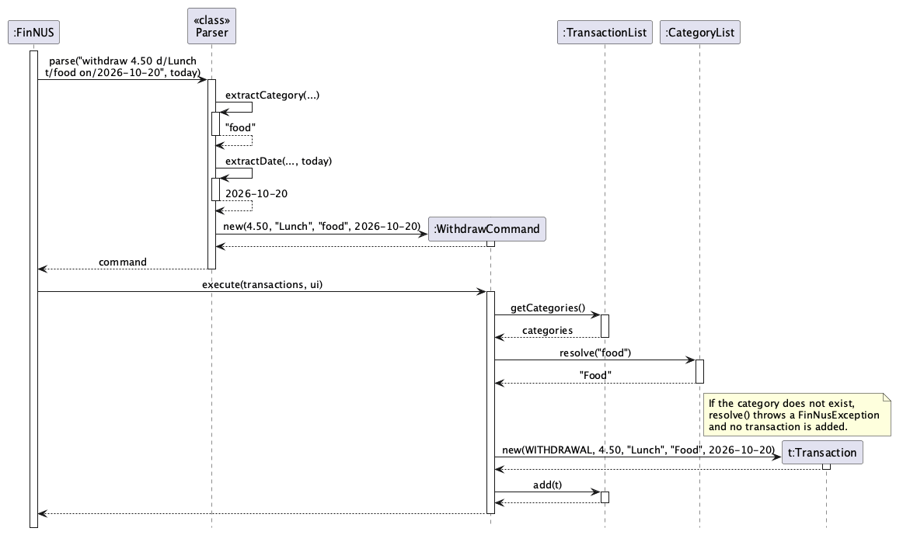

*Figure 17. Processing a dated, categorised withdrawal. [PlantUML source](diagrams/DatedCategorisedWithdrawSequenceDiagram.puml).*

The parser removes `t/food` and `on/2026-10-20` first, so the remaining `4.50 d/Lunch` is split into amount and
description exactly as for a plain withdrawal. The category name is passed to `WithdrawCommand` unchanged, and only
becomes `Food` when `CategoryList#resolve()` runs during `execute()`.

#### Saving dates

The date is saved in ISO format as one more, last field of a `TRANSACTION` record, after the category, e.g.
`TRANSACTION|WITHDRAWAL|4.50|THVuY2g=|Food|2026-10-20`. An empty field means the date is unknown.

Records are told apart by their number of fields. Because a date is only ever saved together with a category,
each count still means exactly one format, so older save files keep loading:

| Fields | SGD transaction | Fields | Foreign-currency transaction |
|--------|-----------------|--------|------------------------------|
| 4 | saved before categories | 7 | saved before categories |
| 5 | with category | 8 | with category |
| 6 | with category and date | 9 | with category and date |

Transactions loaded from rows without a date have a `null` date and are shown without one. A row with an invalid
date is skipped with a warning, like other damaged rows. Loading uses the same format and earliest-date rules as
the parser. The loader does not compare saved dates with today's clock; future-date rejection applies to command input.

#### Design considerations

**Aspect: where today's date comes from**

* **Alternative 1 (current choice):** pass `today` into `Parser#parse()`.
  * Pros: tests can use a fixed date, so they give the same result on any day.
  * Cons: one extra parameter.
* **Alternative 2:** call `LocalDate.now()` wherever it is needed.
  * Pros: simpler code.
  * Cons: tests that check the default date or reject future dates would depend on when they are run.

**Aspect: order of transactions entered with an earlier date**

<!-- @@author lololol8484 -->
* **Alternative 1 (current choice):** insert each transaction into the list by its date.
  * Pros: `recent` and `find` reflect the actual dates, including backdated transactions.
  * Cons: adding a backdated transaction can shift displayed indices, so users need to check the current list before deleting.
* **Alternative 2:** keep transactions in entry order and sort only when displaying them.
  * Pros: adding a transaction never changes the underlying order.
  * Cons: every feature that displays or deletes transactions must independently apply the same date ordering.
<!-- @@author -->

<!-- @@author chancheese -->
### Setting a monthly allowance

`allowance DAY [a/AMOUNT] [c/CURRENCY]` sets the day of the month the user's allowance arrives and, optionally, how
much it is. The day splits time into budget cycles, e.g. day 5 gives cycles from 5 Oct to 4 Nov. With an amount,
FinNUS adds the allowance as a deposit each month by itself. `allowance` shows a summary of the current cycle, and
`allowance off` removes the setting.

#### Classes involved

* `Allowance` (package `finnus.allowance`): an immutable record of the `day`, the optional `amount` and
  `currencyCode`, and `lastCredited`, the latest allowance date that has already been dealt with. It also does all
  the date arithmetic: `cycleStart()`, `cycleEnd()`, `nextDate()`, `daysUntilNext()` and `nextDueDate()`.
* `AllowanceCommand`: sets, shows or stops the allowance, and builds the summary.
* `CreditAllowanceCommand`: adds the deposits that are due. It is not in `CommandWord`, because the user never types
  it; `FinNUS` runs it.
* `TransactionList` holds the setting (`getAllowance()` / `setAllowance()`), next to the rates and categories.

#### Working out the cycle

If a month is shorter than `day`, the allowance arrives on its last day, so `Allowance#dateIn(month, day)` returns
`month.atDay(Math.min(day, month.lengthOfMonth()))`. For example, day 31 gives 28 Feb 2027 and 30 Apr 2026.

`cycleStart(today)` is this month's allowance date if `today` is on or after it, and last month's otherwise. So on
the allowance day itself a new cycle starts, and `daysUntilNext()` is never 0. `nextDate()` is the allowance date in
the month after `cycleStart()`, and `cycleEnd()` is the day before that.

The summary adds up the SGD amounts of transactions dated from `cycleStart()` up to, but not including, `nextDate()`.
Transactions saved before dates existed have no date, so they are left out and counted in a short note instead.

#### How the allowance is added automatically

FinNUS only runs while it is open, so "on the 5th" really means "the first time FinNUS runs on or after the 5th".

1. Setting an allowance calls `Allowance.startingFrom(day, amount, currency, today)`, which sets `lastCredited` to
   `cycleStart(today)`. The allowance date that has just passed, including today, is treated as already received,
   so FinNUS never adds an allowance the user may have recorded by hand. If the same day is set again while an
   allowance is still waiting to be added, the earlier `lastCredited` is kept, so re-entering it never drops that
   deposit. A foreign amount is also converted once when it is set, if a rate exists, so an amount that is out of
   range is rejected straight away rather than on the allowance day.
2. After loading (and setup), `FinNUS#restoreSession()` runs `CreditAllowanceCommand`. While `nextDueDate()` (the
   allowance date in the month after `lastCredited`) is not after today, it adds a `DEPOSIT` described as
   `Allowance`, dated on that allowance date, and moves `lastCredited` forward. If FinNUS was closed for two months,
   both are added, each on its own date.
3. A foreign amount is converted with `CurrencyRates#convert()` at the current rate. If no rate is set, `convert()`
   throws a `FinNusException`; the loop stops without moving `lastCredited`, so that date stays due.
4. Before most normal commands, `FinNUS#prepareAllowance()` credits and saves due allowances so lists and balances
   include them. It skips `edit` and `delete` until those commands consume their displayed indices, and skips `exit`.
   History navigation defers credits to keep its numbering stable. Successful non-exit commands outside history also
   retry crediting afterwards, so a new rate can release a waiting allowance. The same captured command date is used
   throughout. Only startup displays warnings about a due allowance that cannot yet be credited.
5. Each credit updates the pending-change flag, so save failures can be retried even if the following command fails.

Deleting an automatic deposit does not bring it back, because `lastCredited` has already moved past its date.

Today's date comes from a `Clock` given to `FinNUS`. The app uses the system clock, while tests use
`Clock.fixed(...)`, and the date is passed on to `Parser#parse(input, today)`, `Setup#run()` and the commands.

#### Saving the allowance

The setting is saved as one `ALLOWANCE|DAY|AMOUNT|CURRENCY|LAST_CREDITED` record, with empty fields for a missing
amount or SGD, e.g. `ALLOWANCE|5|500||2026-11-05` or `ALLOWANCE|5|60000|JPY|2026-11-05`. `LedgerSnapshot` has an
`allowance` component, so setting, changing or crediting the allowance is detected as a change and saved. Files
without the record load with no allowance. A record with an invalid day, amount, currency or date, or a second
`ALLOWANCE` record, is skipped with a warning like other damaged rows.

#### Design considerations

**Aspect: when an automatic deposit is added**

* **Alternative 1 (current choice):** at startup and around normal commands, for every due date since `lastCredited`.
  * Pros: works even though FinNUS is not always running; missed months are added on their real dates.
  * Cons: needs the extra `lastCredited` field so the same month is never added twice.
* **Alternative 2:** only add the allowance while FinNUS is open on the allowance day.
  * Pros: simpler, with no extra state.
  * Cons: a user who does not open FinNUS on that exact day never gets the deposit.

**Aspect: the first automatic deposit**

* **Alternative 1 (current choice):** start from the next allowance date.
  * Pros: never doubles an allowance the user already recorded with `deposit`.
  * Cons: a user who sets it up after the allowance day must record this month's allowance by hand.
* **Alternative 2:** also add the allowance date that has just passed.
  * Pros: the current cycle is complete straight away.
  * Cons: most users setting this up have already recorded this month's allowance, so it would be counted twice.

**Aspect: where the summary shows this cycle's spending**

* **Alternative 1 (current choice):** a total and count in the summary.
  * Pros: short enough to check every day, alongside the countdown.
  * Cons: does not list the withdrawals; a future cycle filter on `history` is a better fit for that.
* **Alternative 2:** list every withdrawal of the cycle in the summary.
  * Pros: one command shows everything.
  * Cons: a month of logged meals and bus rides is 60 to 100 lines, which hides the countdown.
<!-- @@author -->

<!-- @@author naieel04 -->
### Automatic saving and recovery

**Key classes:** `FinNUS`, `FileStorage`, `LedgerCodec`, `LedgerSnapshot`, `LoadResult`

`FinNUS#executeCommand()` captures a `LedgerSnapshot` before a command runs and compares it with a snapshot captured
after the command returns. A difference marks the session as having pending changes. Snapshots include the opening
balance, transactions, exchange rates, custom categories, allowance settings, and spending-alert settings, so changes
to any of these can trigger a save.

After a successful non-exit command, `savePendingChanges()` attempts to save the current snapshot if changes are pending
and saving is allowed. A successful save clears the pending flag. An `IOException` leaves the flag set and displays an
error, allowing a later successful command or shutdown to retry. A read-only command such as `balance` can therefore
retry an earlier failed save even though it creates no new change itself.

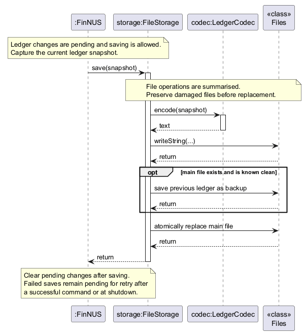

*Figure 18. One successful automatic save. File operations are summarised; failure handling is described in the notes
and recovery table. [PlantUML source](diagrams/AutomaticSaveSequenceDiagram.puml).*

`FileStorage` writes UTF-8 text to a temporary file in the save directory. If the existing main file is known to be clean,
it copies that previous state into `finnus.txt.bak` before atomically replacing the main file. The backup therefore holds
the previous saved state, not a copy of the new snapshot. A damaged main file or backup is preserved in a uniquely named
`.corrupt-*` recovery copy before a save replaces it. Temporary-file clean-up is attempted whether saving succeeds or fails.

#### Loading and recovery

Loading returns a `LoadResult` containing the recovered snapshot, warnings, saving permission, and whether setup is
required. A partially valid main file contributes its valid rows directly; the backup is considered only when the main
file is missing or unrecoverable. Invalid UTF-8 counts as damaged data, whereas other read failures disable saving to
protect data that could not be inspected.

<!-- @@author lololol8484 -->
`LedgerSnapshot#toTransactionList()` restores each decoded transaction through `TransactionList#add()`, so an
unsorted `finnus.txt` still starts with the transactions arranged by date. A later successful save writes the sorted
order. Simply starting the program and running read-only commands does not rewrite the file.
<!-- @@author naieel04 -->

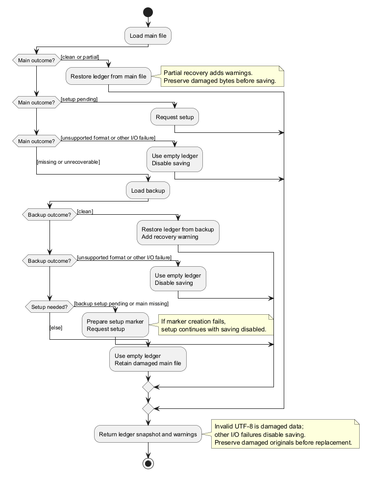

*Figure 19. Startup recovery policy. Guards select the next action; the final node ends loading, not the application.
First-run setup runs afterwards when requested. [PlantUML source](diagrams/StorageRecoveryActivityDiagram.puml).*

| Situation                                                                  | Recovered state and diagnostics                                                                                            | Saving and file protection                                                                                                                                                       |
|----------------------------------------------------------------------------|----------------------------------------------------------------------------------------------------------------------------|----------------------------------------------------------------------------------------------------------------------------------------------------------------------------------|
| Main file missing; backup absent or damaged                                | Request first-run setup.                                                                                                   | Create a setup-pending main file. If initialization fails, setup can continue with saving disabled. An unsupported or unreadable backup follows the disabled-saving rules below. |
| Main file records pending setup                                            | Return an empty snapshot and request opening-balance confirmation.                                                         | Resume setup; save the confirmed balance afterwards if saving is allowed. A setup-pending backup can also restart this process.                                                  |
| Main file contains some invalid rows                                       | Recover valid rows and warn that balances may be incomplete. Unknown withdrawal categories become `Others` with a warning. | Allow saving, but preserve the damaged main file before replacement. Do not fall back to the backup for partial recovery.                                                        |
| Main file missing, unrecoverable, or invalid UTF-8; backup is clean        | Restore the backup snapshot and display a recovery warning.                                                                | Allow saving. Preserve any damaged main-file bytes before replacement and retain the clean backup rather than rotating a damaged main over it.                                   |
| Damaged main file; backup is missing or damaged                            | Return an empty snapshot with corruption warnings.                                                                         | Allow saving, but retain the damaged main file until a save preserves and replaces it. An unsupported or unreadable backup follows the disabled-saving rules below.              |
| Unsupported numbered format in the main file or a backup being considered  | Return an empty snapshot with a format warning.                                                                            | Disable saving for the session; leave incompatible files unchanged.                                                                                                              |
| Other I/O failure while reading the main file or a backup being considered | Return an empty snapshot with a read warning.                                                                              | Disable saving for the session; leave unreadable files unchanged.                                                                                                                |
| Save fails                                                                 | Keep the current ledger in memory and display an automatic-save warning.                                                   | Retain pending changes for retry. Failed atomic replacement leaves its target unchanged; backup rotation may already have completed.                                             |

#### Design considerations

Immutable snapshots provide one representation for change detection and persistence, keeping save decisions out of
individual commands. Versioned text is inspectable and supports recovery of valid rows, but the codec must validate every
external value and preserve compatibility. Capturing and encoding the complete ledger also takes time proportional to
its size. An incremental change log could reduce repeated work, at the cost of more complex replay and recovery logic.

Temporary files and atomic replacement avoid truncating the main file while writing a new snapshot. This approach needs
additional disk space and filesystem support for atomic moves. If replacement is unsupported or fails, the application
reports the failure and retains pending changes instead of falling back to a non-atomic overwrite.

### Validation and error handling

| Boundary          | Responsibility                                                                                      |
|-------------------|-----------------------------------------------------------------------------------------------------|
| Parser            | Validate required arguments, numeric formats, limits, currency codes, and positive indices.         |
| Command execution | Check current state, such as whether a deletion index or category exists.                           |
| Model             | Assert internal invariants; validate external input before it reaches assertion-based constructors. |
| Storage decoding  | Validate records, skip invalid rows, check compatibility, and collect recovery warnings.            |
| Application       | Display expected errors, retain unsaved changes, and communicate save failures.                     |

For example, `withdraw 4.50` reaches `Parser#parseWithdraw()`, which rejects the missing description with a
`FinNusException`. No command is returned or executed, so the ledger is unchanged. `FinNUS#run()` catches the exception,
passes its message to `Ui#showError()`, and reads the next command. Any changes still pending from an earlier command
remain available for a later save attempt.

<!-- @@author -->
<!-- @@author nkyjStar -->
### Financial charts

**Feature and status:** Financial charts — implemented. Both commands read the ledger without
changing it.

**Commands and classes:**

| Command or class | Responsibility |
|------------------|----------------|
| `chart flow from/START to/END int/PERIOD [p/PAGE]` → `ChartFlowCommand` | Summarise deposit and withdrawal totals over a date range, up to four periods per page. |
| `chart spending [int/PERIOD on/DATE]` → `ChartSpendingCommand` | Show withdrawal totals by category, overall or for one calendar period. |
| `Parser`, `CommandWord` | Validate chart arguments and provide separate help rows for the two forms. |
| `ChartPeriod`, `ChartBar` | Share calendar boundaries and render scaled text bars with exact SGD totals. |

**Mechanism and walkthrough:**

1. `Parser#parseChart()` chooses the form and checks its fields. `ChartPeriod.parse()` returns a
   shared `DAY`, `WEEK`, `MONTH`, or `YEAR` constant; `startOf()` and `nextStart()` define its
   calendar boundaries, with an exclusive end. Weeks start on Monday.
2. For `chart flow from/2026-10-20 to/2026-10-22 int/WEEK`, `ChartFlowCommand` labels the week
   `2026-10-19` to `2026-10-25`, but counts transactions only from 20 to 22 October. It sums
   deposits and withdrawals separately using `Money`. Empty periods show zero. The command counts
   all intersecting periods, then shows up to four on the requested `p/PAGE` (default 1).
3. For `chart spending int/MONTH on/2026-10-21`, `ChartSpendingCommand` sums October withdrawals
   by category in `CategoryList` order. With no filter, it sums all recorded withdrawals. Foreign
   withdrawals use their stored SGD amounts; deposits and the opening balance are excluded.
4. `ChartBar` scales each bar to the largest total in the displayed chart and prints the exact
   amount beside it. The UI displays the result, and the command finishes without entering a mode.

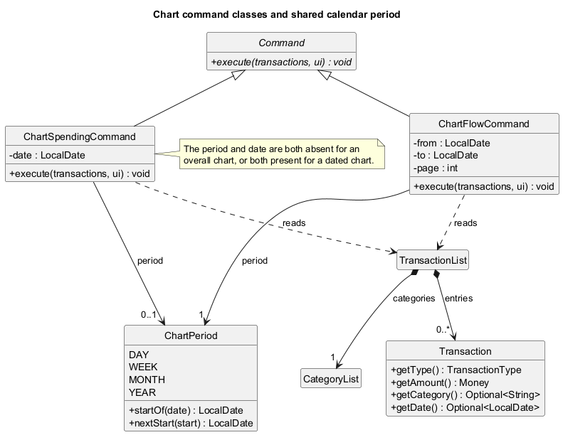

*Figure 20. A flow command has one `ChartPeriod`; a spending command has zero or one. Both read a
`TransactionList`, which has one category list and zero or more transactions. Dashed dependencies
have no multiplicity. [PlantUML source](diagrams/ChartClassDiagram.puml).*

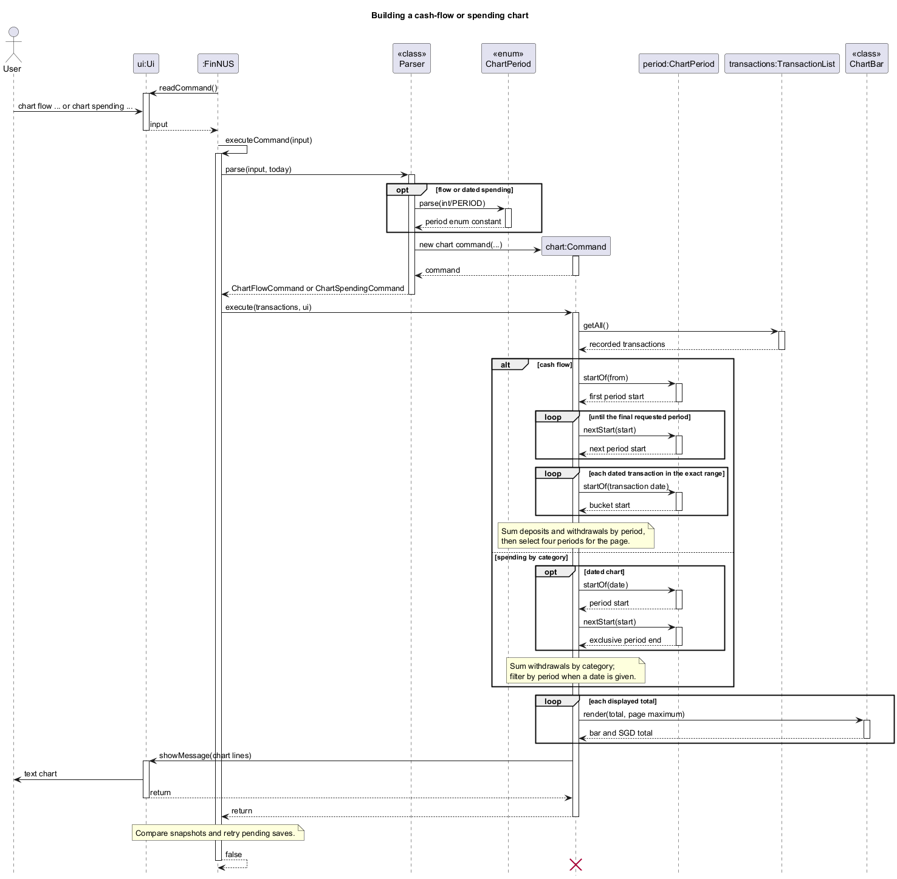

*Figure 21. Parsing and displaying either chart form. The enum lifeline receives static `parse()`;
`period:ChartPeriod` receives calls on the returned constant. The chart command's lifeline ends when
its local reference leaves scope, without implying immediate garbage collection. Activation bars
show execution; dashed arrows show returns. Snapshot comparison and pending-save retry are
summarised; allowance handling is omitted. [PlantUML source](diagrams/ChartSequenceDiagram.puml).*

**Design considerations:**

**Aspect: navigating flow pages**

* **Alternative 1 (current choice):** run a separate `chart flow` command for each `p/PAGE`.
  * Pros: users can run any normal command between pages; the full command records the selected
    range, interval, and page without keeping view state in `FinNUS`.
  * Cons: users must repeat the command to change pages; there are no `next` or `prev` shortcuts.
* **Alternative 2:** keep an interactive chart mode like history mode.
  * Pros: `next` and `prev` would make adjacent pages quicker to reach.
  * Cons: `FinNUS` would need to retain the chart type, dates, interval, and page. If it routed
    input like history mode, users would need `stop` before running normal commands.

**Aspect: defining time intervals**

* **Alternative 1 (current choice):** group by calendar day, week, month, or year.
  * Pros: labels match familiar calendar periods, and both charts place a date in the same period.
  * Cons: first and last flow periods can be partial, so their totals must be filtered to the
    requested dates; months and years also have different lengths.
* **Alternative 2:** use rolling seven-day, 30-day, and 365-day windows.
  * Pros: each window of a given type has a fixed duration.
  * Cons: windows depend on the chosen start date and do not align with named weeks, months, or
    years, making the labels and category comparisons less familiar.

**Aspect: sharing interval rules**

* **Alternative 1 (current choice):** use one `ChartPeriod` enum for the four supported intervals.
  * Pros: flow and spending share the same boundary calculations with little extra code.
  * Cons: adding a new interval requires changing the enum and its methods.
* **Alternative 2:** define a separate strategy class for each interval.
  * Pros: new or user-defined calendars could be added as new implementations.
  * Cons: extra classes and selection logic add complexity for a fixed set of four intervals.

**Aspect: rendering the charts**

* **Alternative 1 (current choice):** print ASCII bars and exact SGD totals in the console.
  * Pros: works with the existing `Ui` and needs no graphical dependency.
  * Cons: text bars offer less detail and interaction than graphical plots.
* **Alternative 2:** open a graphical chart view.
  * Pros: could provide richer plots, legends, and interactive inspection.
  * Cons: needs a graphical interface or library beyond the current CLI.

**Aspect: scaling bars across flow pages**

* **Alternative 1 (current choice):** scale each page to its largest displayed total.
  * Pros: small values remain visible even when another page contains a much larger value.
  * Cons: bar lengths cannot be compared across pages; users must compare the printed totals.
* **Alternative 2:** use one maximum for every page in the requested range.
  * Pros: equal bar lengths would represent equal amounts across pages.
  * Cons: an unusually large total could make most other bars too short to distinguish.

**Aspect: obtaining chart totals**

* **Alternative 1 (current choice):** recalculate from the ledger for each request.
  * Pros: results reflect transactions added or removed between commands, without cache rules.
  * Cons: another page scans the ledger again; flow also enumerates the range to count pages.
* **Alternative 2:** cache totals between chart commands.
  * Pros: repeated views of an unchanged range could be faster.
  * Cons: the cache would need invalidation whenever transactions or their categories change,
    adding state and a risk of showing stale totals.

**Validation and limitations:**

* The parser rejects missing, duplicate, and unknown fields; invalid dates; periods outside the
  four enum values; and non-positive or oversized page numbers. Spending requires both `int/PERIOD`
  and `on/DATE` when filtered. Dates must be from 2000-01-01 through today, with `from <= to` for
  flow. An unavailable page raises `FinNusException` before output is shown.
* Undated legacy transactions cannot appear in a dated chart or flow period. Overall spending
  includes undated withdrawals. Categories with no spending are omitted; an empty spending chart
  shows a message. Neither command changes the ledger.
* `ParserChartTest` and `ChartCommandTest` cover syntax, boundaries, pagination, partial weeks,
  category totals, and empty results. Both commands log requests and results at `FINE`; invalid
  chart syntax and out-of-range flow pages log at `WARNING`. Logs omit amounts and category names.

<!-- @@author -->

---

<!-- @@author naieel04 -->
## Documentation, logging, testing, and DevOps

### Documentation and diagrams

- [User Guide](UserGuide.md): command syntax and user-facing behaviour.
- [README](../README.md): project overview and contributor setup information.
- [Build configuration](../build.gradle): Java toolchain, dependencies, packaging, and checks.

Editable PlantUML files are in `docs/diagrams`, and the guide displays their exported PNGs from
`docs/images`. Each figure caption links to its source. After changing a diagram, regenerate its PNG with
PlantUML and check that the source and displayed image agree.

Keep diagrams consistent with the code. Explain relationships, number figures, and link images to their editable sources.

### Logging

`FinNUS.main()` configures `java.util.logging` to append diagnostics to `finnus.log` in the working directory. If the log
file cannot be created, logging is disabled. Command arguments and failed input can currently appear in diagnostics.

<!-- @@author -->

<!-- @@author chancheese -->
Routine steps use `FINE`, state changes such as an added deposit use `INFO`, and storage problems use `WARNING`.
The log can contain amounts and descriptions, so check it before sharing it.
<!-- @@author -->

<!-- @@author naieel04 -->

### Automated testing and continuous integration

Tests are in `src/test/java/finnus`, including parser, command, model, storage, and persistence integration tests.
Run `check` using the setup table above. GitHub Actions runs checks with Java 25 on Windows, macOS, and Linux.

<!-- @@author -->

<!-- @@author chancheese -->
Storage tests use JUnit `@TempDir`, so they never touch a real `finnus.txt`. Command tests check the exact
printed output. Each pull request needs one approving review before it is merged.
<!-- @@author -->

---

<!-- @@author naieel04 -->
## Product scope

### Target user profile

FinNUS targets tech-savvy university students managing a tight monthly budget. This includes international students
handling foreign-currency allowances and local students managing daily campus expenses. The intended user is comfortable
with a command-line interface.

### Value proposition

FinNUS provides a streamlined desktop CLI to help students understand how they can safely spend their allowance. It aims
to make allowance and campus-expense tracking straightforward, including for students dealing with foreign currency.

### Release scope

<!-- @@author -->

<!-- @@author chancheese -->
v2.1 includes:

- deposits and withdrawals, with an optional date, category and foreign currency
- the opening balance, `balance`, `recent`, `history`, `find`, `edit` and `delete`
- exchange rates, custom categories, and a monthly allowance that is added automatically
- automatic saving, with recovery from damaged files

It includes editing deposits and withdrawals, including their historical foreign amounts and exchange rates.
It also includes cash-flow and category-spending charts, plus configurable spending alerts. It does not include
a cycle-filtered transaction list or a daily budget. See
[Planned enhancements](#planned-enhancements).
<!-- @@author -->

---

<!-- @@author naieel04 -->
## User stories
<!-- @@author -->

<!-- @@author chancheese -->
Financial charts are implemented. A dedicated cycle-filtered transaction list is not implemented yet;
`allowance` shows cycle totals, while `chart spending` supports calendar periods.
<!-- @@author -->

<!-- @@author naieel04 -->

| ID    | As a/an...               | I want to...                                                            | So that...                                 |
|-------|--------------------------|-------------------------------------------------------------------------|--------------------------------------------|
| US-01 | lazy user                | set the day my allowance arrives                                        | the app knows my budgeting cycle           |
| US-02 | habitual user            | view all transactions                                                   | I can review my spending history           |
| US-03 | international student    | record an incoming allowance with its amount and received exchange rate | the app knows its value in SGD             |
| US-04 | forgetful user           | categorise my spending                                                  | I can later see where my money went        |
| US-05 | disciplined user         | list this cycle's spending                                              | I can check that nothing is missing        |
| US-06 | power user               | see my balance through visual charts                                    | I can see my financial status clearly      |
| US-07 | forward-planning student | see how many days remain until my next allowance                        | I can pace my spending                     |
| US-08 | careless user            | edit a deposit's amount, description, date, or saved exchange rate       | a mistyped entry does not distort my balance |
| US-09 | distracted user          | edit a withdrawal, including its category and saved exchange rate        | my spending records stay accurate          |

<!-- @@author -->

---

<!-- @@author naieel04 -->
## Use cases

### UC-01: Record a foreign-currency allowance

**Actor:** FinNUS user

**Related story:** US-03 (record an incoming allowance)

**Preconditions:** FinNUS is running and an exchange rate has been set for the allowance currency.

**Postconditions:** The allowance is stored as an SGD transaction with its original currency amount and rate; the updated ledger is saved.

**Main success scenario:**

1. The user enters `deposit 1100 d/Allowance c/JPY`.
2. FinNUS validates the amount and currency, converts JPY to SGD using the configured rate, and records the transaction.
3. FinNUS displays the SGD value and rate used, then saves the ledger.

**Extensions:**

- **2a. No JPY rate is set or the input is invalid:** FinNUS displays an error and leaves the ledger unchanged.
- **3a. Saving fails:** FinNUS reports that the change remains in memory and retries on a later command or before exit.

### UC-02: Review transaction history

**Actor:** FinNUS user

**Related story:** US-02

<!-- @@author nkyjStar -->
**Preconditions:** FinNUS is running.

**Main success scenario:**

1. The user enters `history n/2`. FinNUS displays the two transactions with the newest dates first.
2. The user enters `next`. FinNUS displays the next two transactions, if available.
3. The user enters `stop`. FinNUS returns to the normal command loop.

**Extensions:** An empty ledger displays an empty-list message while keeping history mode active.
During an active view, an out-of-range page or page size reports an error without changing the current view.
<!-- @@author naieel04 -->
<!-- @@author -->

<!-- @@author naieel04 -->

### UC-03: Correct a recorded transaction

**Actor:** FinNUS user

**Related stories:** US-08 and US-09 in this guide.

**Preconditions:** Setup is complete, at least one transaction exists, and history mode is inactive.

**Postconditions:** The selected entry is corrected without changing its type, currency, or the transaction count.
The balance reflects the corrected values, and FinNUS attempts to save them.

**Main success scenario:**

1. The user enters `recent` or `find` and chooses a displayed transaction number.
2. The user enters an edit such as `edit 1 a/6.50 t/food`.
3. FinNUS validates all changes, requests confirmation for newly crossed withdrawal alert thresholds, and replaces
   the selected entry only if approved or no confirmation is needed, maintaining chronological order.
4. FinNUS displays the before/after entries and automatically saves the ledger.

**Extensions:**

- **2a. History is active:** The user must enter `stop` before `edit` is accepted.
- **3a. Invalid index, field, category, or resulting amount:** FinNUS reports the error; the selected entry is unchanged.
- **3b. All supplied values match:** FinNUS displays `No changes made.`; no edit-induced save is needed.
- **3c. A date changes:** The corrected entry may get a different index; the user checks the list before editing again.
- **3d. A spending alert is declined or its input ends:** FinNUS displays `Edit cancelled.` and retains the entry.
- **4a. Saving fails:** FinNUS reports that the correction remains in memory and retries on a later command or at exit.

<!-- @@author -->

---

<!-- @@author naieel04 -->
## Non-functional requirements

The following quality requirements are derived from the product goals.

| ID     | Quality            | Proposed requirement                                                                                                                                                                                                                                    | How to verify                                                                                                                    |
|--------|--------------------|---------------------------------------------------------------------------------------------------------------------------------------------------------------------------------------------------------------------------------------------------------|----------------------------------------------------------------------------------------------------------------------------------|
| NFR-01 | Financial accuracy | Monetary calculations must use decimal arithmetic. Displayed SGD balances must equal the opening balance plus deposits minus withdrawals, to the cent. Converted allowances must use the rate recorded for that deposit and a documented rounding rule. | Test decimal edge cases, repeated additions, deposits in foreign currencies, and balance totals against hand-calculated results. |
| NFR-02 | Data integrity     | A rejected command must not apply its requested changes. Independently due allowance credits may still be recorded and saved. A completed state change must either be saved or clearly reported as unsaved.                                                                                                                       | Exercise invalid input and simulated storage failures; compare ledger state before and after.                                    |
| NFR-03 | Persistence        | The opening balance, transactions, and exchange rates must be available after restarting the application.                                                                                                                                               | Create sample ledger data, exit, restart using the same data folder, and compare restored values.                                |
| NFR-04 | Usability          | The app must be usable from the desktop command line. Invalid input must produce a clear explanation and leave the app ready for the next command.                                                                                                      | Manually test documented commands, malformed inputs, and recovery with a following valid command.                                |
| NFR-05 | Compatibility      | The application must run with Java 25 on the operating systems supported by the project.                                                                                                                                                                | Build and run the automated checks on Windows, macOS, and Linux CI environments.                                                 |

<!-- @@author -->

<!-- @@author chancheese -->
FinNUS supports Windows, macOS and Linux. Amounts are rounded half-up to the cent for display. Foreign amounts are
also rounded half-up to the cent when they are recorded.
<!-- @@author -->

---

<!-- @@author naieel04 -->

## Glossary

| Term              | Meaning                                                                                       |
|-------------------|-----------------------------------------------------------------------------------------------|
| CLI               | Command-line interface accepting text commands.                                               |
| Ledger            | Transactions, opening balance, exchange rates, and custom spending categories held by FinNUS. |
| Opening balance   | Funds held before recording transactions; separate from transaction history.                  |
| Base currency     | SGD, used for transaction amounts and balances.                                               |
| Exchange rate     | Foreign-currency units equivalent to one SGD.                                                 |
| Snapshot          | An immutable value copy of financial state for persistence and change detection.              |
| Recent-list index | A one-based position counting from the newest transaction.                                    |

<!-- @@author -->

---

<!-- @@author naieel04 -->
## Instructions for manual testing

Run each scenario on the release JAR and compare the result with the expected one.

### Test environment and sample data

1. Use Java 25 and build the JAR with `shadowJar`.
2. Copy `build/libs/finnus.jar` into a separate, empty test folder and run `java -jar finnus.jar` there.
3. For each independent scenario, use a fresh folder unless it explicitly tests restart or recovery.

On first launch, enter `100` as the opening balance and confirm it with `yes`. Press Enter to skip the balance alert
threshold and allowance setup. Then create the sample ledger with:

```text
deposit 50 d/Allowance
withdraw 4.50 d/Lunch
rate JPY 110
```

The expected balance is **SGD 145.50**, with two transactions and one exchange rate. The newest transaction is the
withdrawal. Restarting in the same folder does not reset the saved ledger.

### Functional scenarios

| ID    | Preconditions                                           | Steps / input                                                                          | Expected result                                                                                                    |
|-------|---------------------------------------------------------|----------------------------------------------------------------------------------------|--------------------------------------------------------------------------------------------------------------------|
| MT-01 | Fresh folder                                            | Launch, enter opening balance `100`, confirm with `yes`, press Enter to skip the balance threshold and allowance, then enter `help` and `exit`. | Setup, welcome, and help appear; the process exits.                                                                |
| MT-02 | First-run setup completed with opening balance SGD 100  | Enter sample commands, then `balance`.                                                 | Two transactions, JPY rate 110, balance SGD 145.50.                                                                |
| MT-03 | Sample ledger                                           | Enter `recent 2`, `delete 1`, then `balance`.                                          | Lunch is deleted, Allowance remains, balance SGD 150.00.                                                           |
| MT-04 | Fresh folder; complete setup with opening balance SGD 0 | Enter `withdraw 4.50`, `deposit 0`, `delete 1`, then `balance`.                        | Each invalid operation reports an error; ledger remains empty with balance zero.                                   |
| MT-05 | Sample ledger                                           | Enter `rate JPY 120`, then `rate`.                                                     | JPY changes to 120 without a duplicate entry.                                                                      |
| MT-06 | Saved sample ledger                                     | Exit, restart, then enter `balance`, `recent 2`, and `rate`.                           | Opening balance, transactions, and rate are restored.                                                              |
| MT-11 | Fresh folder | Complete setup with opening balance 100, allowance day `5` and amount `500`, then enter `balance`. | The summary shows the cycle and countdown; `balance` adds a "Next allowance in ..." line. No deposit is added yet. |
| MT-12 | Save file with `ALLOWANCE\|5\|500\|\|2026-08-05`, run on 5 Oct 2026 | Launch, then enter `recent`. | one `Allowance added`: lines for each 5th of the month from 5 Sep up to today”.                                    |
| MT-13 | Save file with `ALLOWANCE\|5\|60000\|JPY\|2026-08-05` and no JPY rate; run on 5 Oct 2026 | Launch, then enter `rate JPY 120`. | A warning at startup; both allowances are added right after the rate is set.                                       |

<!-- @@author lololol8484 -->
For the spending-alert check, use a fresh folder and complete setup with opening balance `100` and balance threshold
`90`. Skip the allowance, enter `withdraw 20 d/Books`, answer `no`, then enter `balance`. The alert lists the balance
threshold and opening balance; the withdrawal is cancelled, so the balance remains `$100.00`.
<!-- @@author -->

<!-- @@author nkyjStar -->

### History navigation scenario

| ID    | Preconditions       | Steps / input                                                       | Expected result                                                                                                           |
|-------|---------------------|---------------------------------------------------------------------|---------------------------------------------------------------------------------------------------------------------------|
| MT-14 | Sample ledger with two transactions | Enter `history n/1`, `next`, `prev`, `n/2`, `exit`, `stop`, then `exit`. | History shows ranges 1-1, 2-2, 1-1, and 1-2. The first `exit` is rejected in history mode; the second closes FinNUS. |
| MT-15 | Saved sample ledger; restart FinNUS | Enter `history p/10000000000000000`. | FinNUS reports `History page is out of range.` |

<!-- @@author naieel04 -->

### Transaction editing scenarios

Run each case independently from the sample ledger above unless it says to restart the same session.

| ID | Steps / input | Expected result |
|----|---------------|-----------------|
| MT-16 | Enter `recent`, `edit 1 a/6.50 t/food`, then `balance` and `find t/food`. | Lunch changes to SGD 6.50 in Food; the deposit is unchanged, count remains 2, and balance is SGD 143.50. |
| MT-17 | Enter `deposit 55000 c/JPY d/Foreign allowance`, `rate JPY 120`, `edit 1 r/100`, `edit 1 a/60000`, then `rate` and `balance`. Exit, restart, and enter `recent` and `balance`. | The foreign deposit changes from SGD 500 to 550, then 600. Its saved rate remains 100 for the amount-only edit, global JPY stays 120, count is 3, and balance is SGD 745.50 before and after restart. |
| MT-18 | Enter `edit 1 a/6.50 t/Unknown`, `edit 1 d/`, `edit 2 t/food`, `edit 99 a/1`, then `edit 1 a/4.50` and `balance`. | The first four edits report errors without changing entries. The fifth reports `No changes made.` Balance remains SGD 145.50 and count remains 2. |
| MT-19 | Enter `edit 1 on/2000-01-01`, then `recent`. Exit, restart, and enter `history` and `stop`. | Lunch moves behind the newer deposit and has index 2 in both views. Its date survives restart; balance stays SGD 145.50. |
| MT-20 | Use the folder permission procedure in MT-10, but issue `edit 1 a/6.50`. Restore write access, enter `balance`, then exit and restart. | The edit first reports an automatic-save failure while remaining visible in memory. After retry and restart, Lunch is SGD 6.50 and balance is SGD 143.50. |
| MT-21 | Enter `edit 2 d/`, then `recent`, `history`, `edit 1 a/6.50`, `stop`, and `balance`. | The deposit description is cleared. History rejects the edit until `stop`; Lunch stays SGD 4.50 and balance stays SGD 145.50. |

Also check `edit 1 a/0`, duplicate fields, an empty `r/`, `c/SGD`, and an SGD entry with `r/100`.
For a foreign transaction, a correction that rounds to SGD zero or exceeds SGD 1000000 must be rejected atomically.
The corresponding automated boundary and rounding cases are in `ForeignEditCommandTest`.

### Storage and recovery scenarios

Use disposable test copies and stop the application before editing fixture files.

<!-- @@author -->

<!-- @@author chancheese -->

| ID    | Setup | Steps | Expected result |
|-------|-------|-------|-----------------|
| MT-07 | Sample ledger; add the row `TRANSACTION\|WITHDRAWAL\|abc\|eA==` to `finnus.txt` | Launch, enter `balance`, then `deposit 1`. | A warning names the skipped row, and the balance is SGD 145.50. After `deposit 1`, the damaged file is kept as `finnus.txt.corrupt-*`. |
| MT-08 | Sample ledger; copy `finnus.txt` to `finnus.txt.bak`, then replace `finnus.txt` with the text `garbage` | Launch, then enter `balance`. | FinNUS restores the backup, and the balance is SGD 145.50. Files stay unchanged until a command changes the ledger. |
| MT-09 | Sample ledger; change the first line of `finnus.txt` to `FINNUS\|9` | Launch, enter `deposit 5`, then `exit`. | A warning says saving is disabled. `deposit 5` shows a "Changes are in memory only" error, and `finnus.txt` is unchanged. |
| MT-10 | Sample ledger; remove write access to the folder, e.g. `chmod a-w .` on macOS or Linux | Launch and enter `deposit 5`. Restore write access, then enter `balance`. | `deposit 5` shows "Automatic save failed". After `balance`, the deposit is saved. |

Boundary cases:

- `deposit 1000000` is accepted; `deposit 1000000.01` and `deposit 0.001` are rejected.
- `rate JPY 1000000` is accepted; `rate JPY 1000001` is rejected.
- `recent 0`, `delete 0` and an index past the end are rejected; `recent 99` lists every transaction.
- `find` alone and `withdraw 4.50` without a description show the expected format.

<!-- @@author -->

---

<!-- @@author naieel04 -->
## Planned enhancements
<!-- @@author -->

<!-- @@author chancheese -->

These features are not in v2.1.

| Enhancement | User need | Proposed design |
|-------------|-----------|-----------------|
| List one cycle's spending | Check every spend since the allowance arrived | A cycle filter on `history`, using the dates from `Allowance`. |
| Daily budget | Know how much is safe to spend today | `balance` divides the balance by the days left until the next allowance. |

<!-- @@author -->
