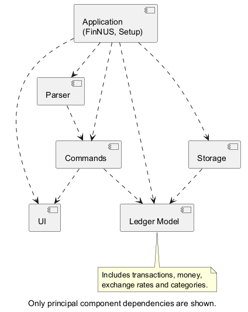
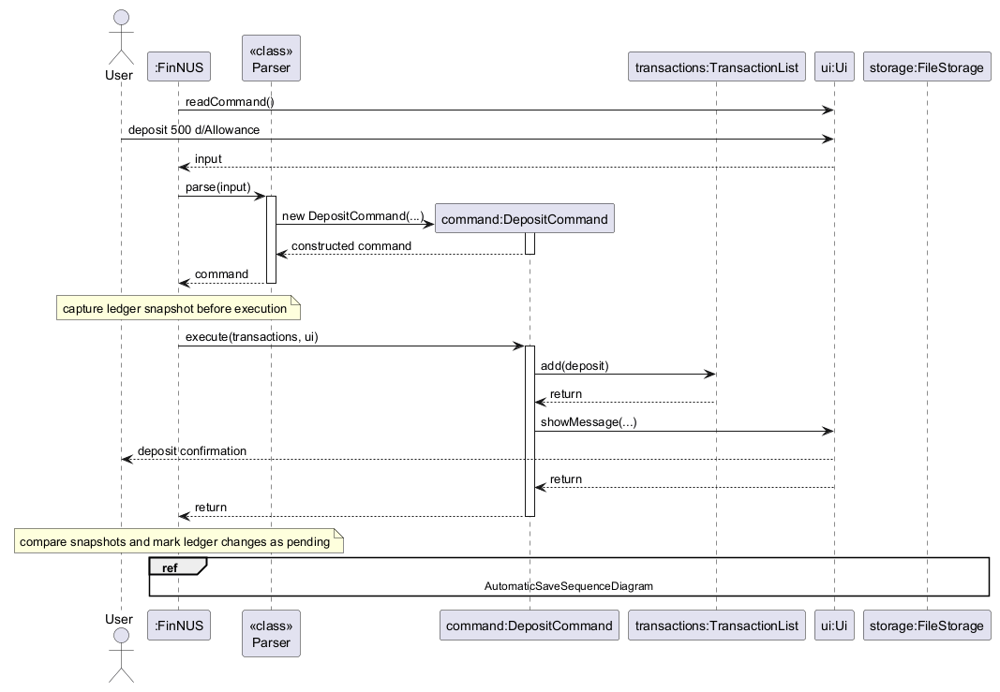
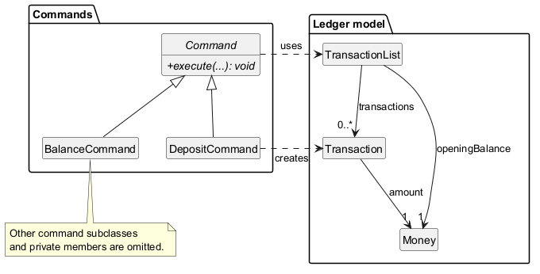
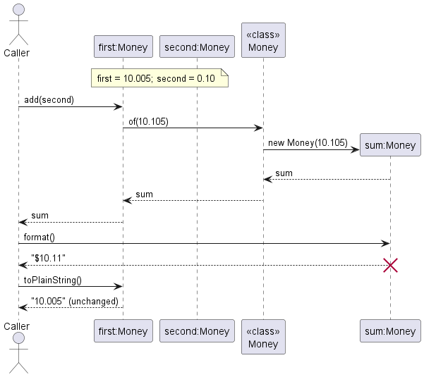
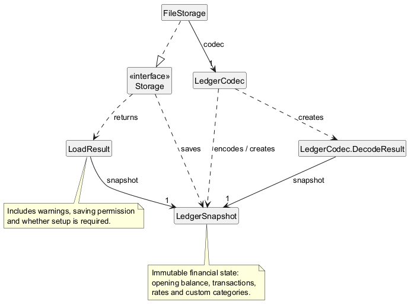
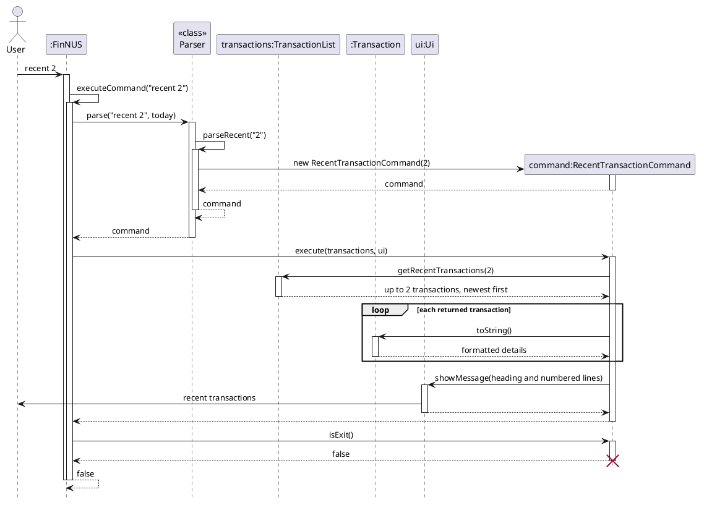
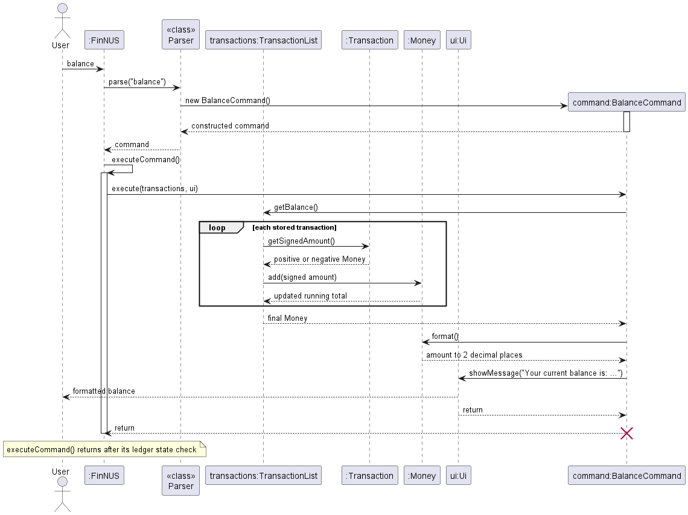
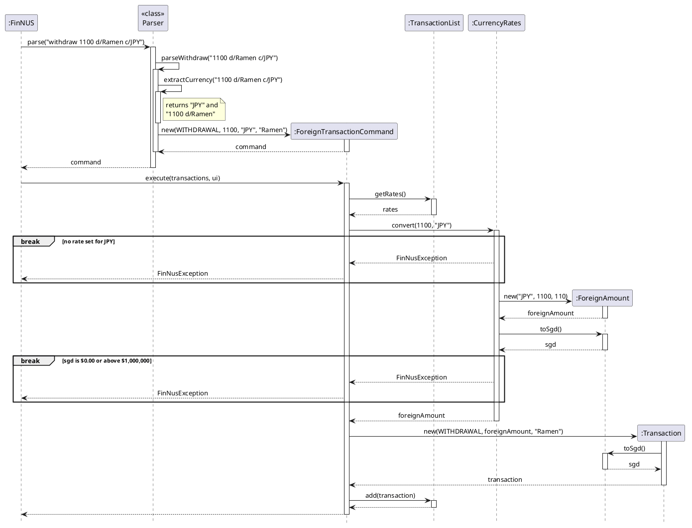
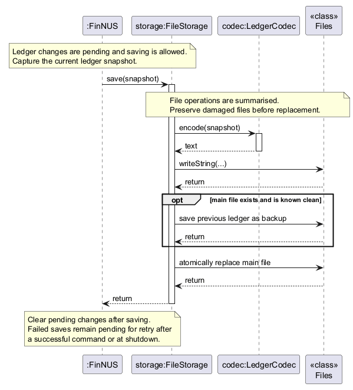
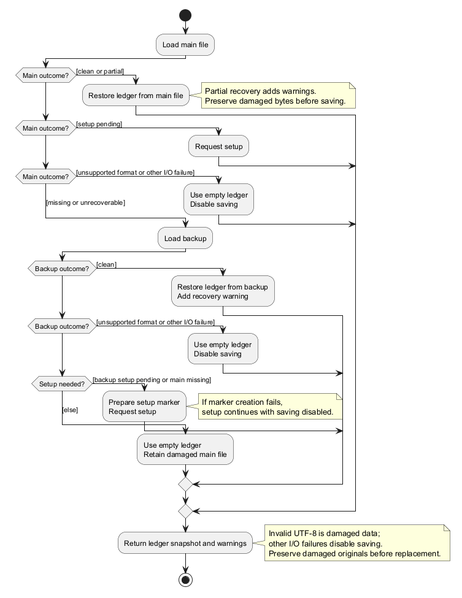

# FinNUS Developer Guide

FinNUS is a command-line personal finance tracker. This guide explains how to set up, understand, extend, and test it.

**Release:** [Release Page](https://github.com/AY2627S1-CS2113-W13-2/tp/releases)

> Draft status: Some sections still contain prompts for team decisions or release-specific details.

---

## Table of contents

- [Acknowledgements](#acknowledgements)
- [Setting up and getting started](#setting-up-and-getting-started)
- [Design](#design)
- [Implementation](#implementation)
- [Documentation, logging, testing, and DevOps](#documentation-logging-testing-and-devops)
- [Product scope](#product-scope)
- [User stories](#user-stories)
- [Use cases](#use-cases)
- [Non-functional requirements](#non-functional-requirements)
- [Glossary](#glossary)
- [Instructions for manual testing](#instructions-for-manual-testing)
- [Planned enhancements](#planned-enhancements)

---

<!-- @@author naieel04 -->
## Acknowledgements

The following resources support the project and this guide:

- [CS2113 project template](https://github.com/NUS-CS2113-AY2627-S1/tp): provides the starter structure and conventions
  for projects in the CS2113 module.
- [Address Book Level 3](https://se-education.org/addressbook-level3/): reference for code quality, project structure,
  and developer-guide organisation.
- [Gradle](https://gradle.org/): builds the project and runs automated checks and tests.
- [JUnit 5](https://junit.org/junit5/): supports automated unit and integration tests.
<!-- @@author -->

---

<!-- @@author naieel04 -->
## Setting up and getting started

### Prerequisites

- JDK **25**, configured for both the IDE project SDK and Gradle JVM.
- Git and a Java-compatible IDE, such as IntelliJ IDEA.
- Internet access for the initial build to download Gradle and dependencies.

On macOS, use `sdk use java 25.0.3.fx-zulu` if switching Java versions with SDKMAN.

### Importing, building, and running

1. Clone the repository: [W13-2 Repo](https://github.com/AY2627S1-CS2113-W13-2/tp/).
2. Open the repository root containing `build.gradle` and import it as a Gradle project.
3. Confirm that `java -version` reports Java 25 and that the IDE's Gradle JVM uses Java 25.
4. Run the following commands from the repository root.

| Task                     | Windows PowerShell        | macOS / Linux         |
|--------------------------|---------------------------|-----------------------|
| Run from source          | `.\gradlew.bat run`       | `./gradlew run`       |
| Run automated tests      | `.\gradlew.bat test`      | `./gradlew test`      |
| Run tests and Checkstyle | `.\gradlew.bat check`     | `./gradlew check`     |
| Package the application  | `.\gradlew.bat shadowJar` | `./gradlew shadowJar` |

Run the packaged application using `java -jar build/libs/finnus.jar`. Enter `help` to view commands and `exit` to quit.
The application entry point is `finnus.FinNUS`.
<!-- @@author -->

---

## Design

<!-- @@author naieel04 -->
### Architecture

`FinNUS` coordinates startup, command execution, and persistence. The parser produces command objects, which read or
modify the ledger and display results through the UI. Storage loads and saves complete ledger snapshots.



*Figure 1. FinNUS architecture and component dependencies. [PlantUML source](diagrams/ArchitectureDiagram.puml).*

| Component       | Main classes / package                                                  | Responsibility                                                                                               |
|-----------------|-------------------------------------------------------------------------|--------------------------------------------------------------------------------------------------------------|
| Application     | `finnus.FinNUS`, `finnus.Setup`                                         | Restore state, guide first-run setup, run commands, detect changes, save pending state, and handle shutdown. |
| UI              | `finnus.ui.Ui`                                                          | Read console input and display messages, errors, and command results.                                        |
| Parser          | `finnus.parser.Parser`                                                  | Validate command syntax and construct a command.                                                             |
| Commands        | `finnus.command`                                                        | Execute operations through the shared `Command` abstraction.                                                 |
| Ledger model    | `TransactionList`, `Transaction`, `TransactionType`                     | Maintain transactions, opening balance, and balance calculation.                                             |
| Currency model  | `CurrencyRates`                                                         | Maintain user-entered exchange rates relative to SGD.                                                        |
| Category model  | `CategoryList`                                                          | Maintain predefined and custom spending categories for withdrawals.                                          |
| Storage         | `Storage`, `FileStorage`, `LedgerCodec`, `LedgerSnapshot`, `LoadResult` | Encode, persist, validate, and recover financial state.                                                      |
| Expected errors | `FinNusException`                                                       | Carry command failure messages to the application's error handler.                                           |

### Application lifecycle

1. `FinNUS` loads a `LoadResult` through `Storage` and reconstructs the ledger.
2. `Ui` reads a line; `Parser.parse()` validates it and returns a `Command`.
3. The command executes against `TransactionList` and displays its result through `Ui`.
4. `FinNUS` compares ledger snapshots to detect changes and attempts to save pending changes.
5. `exit` or end of input ends the loop; pending changes are retried before shutdown.



*Figure 2. A successful SGD deposit after setup. The reference frame expands into Figure 9's saving sequence.
Transaction construction and snapshot internals are omitted.
[PlantUML source](diagrams/CommandExecutionSequenceDiagram.puml).*

Blank input is ignored. If parsing or execution throws a `FinNusException`, the main loop displays its message through
`Ui#showError()` and continues accepting commands. Both `exit` and end of input trigger a final attempt to save pending
changes. If that attempt fails or saving is disabled, FinNUS warns that unsaved changes will be lost after exit.

### UI, parser, and commands

`CommandWord` defines names, descriptions, and usage strings shared by the parser and help output. Concrete commands
extend `Command` and implement `execute(TransactionList, Ui)`.

The class diagram shows how `DepositCommand` and `BalanceCommand` extend `Command` and use `TransactionList`.
`DepositCommand` represents commands that add transactions; `BalanceCommand` represents commands that read ledger state.
Other subclasses, private members, and parser and UI relationships are omitted.



*Figure 3. Command and ledger model relationships. [PlantUML source](diagrams/CommandClassDiagram.puml).*

#### Parsing vs execution responsibilities

1. **Separation of concerns:** `Parser` is responsible solely for syntax validation, prefix extraction (`d/`, `c/`, `t/`), and format verification. It converts raw string tokens into validated values (such as `Money` or currency codes) and constructs concrete, immutable `Command` objects.
2. **Stateless command execution:** Commands encapsulate user intent but do not retain long-lived references to application state. Instead, `Command#execute(TransactionList, Ui)` receives the working `TransactionList` as an argument when executed by the main loop.
3. **Domain mutation example (`DepositCommand`):**
   - The user inputs `deposit 50 d/Allowance`.
   - `Parser#parseDeposit()` verifies that `50` is a valid positive monetary value at or below `Money.MAX_AMOUNT`, extracts the optional description, and constructs a `DepositCommand(amount, description)`.
   - When `DepositCommand#execute(transactions, ui)` runs, it creates a new immutable `Transaction(TransactionType.DEPOSIT, amount, description)` and invokes `transactions.add(transaction)`.
   - `TransactionList` stores the new `Transaction` in entry order. The `Money` value object remains shared and immutable across calculations such as `TransactionList#getBalance()`.
<!-- @@author -->

<!-- @@author nkyjStar -->
### Representing money

`Money` is the shared value type for monetary amounts. The parser creates it from user input,
`Transaction` stores it, `TransactionList` uses it to calculate balances, and storage writes its
exact decimal value. Keeping these operations in one class prevents different commands from
making different choices about arithmetic and display. `Money` is a value object: two instances
represent the same amount when their numerical values are equal, even if they were constructed
from differently scaled decimals such as `10` and `10.00`.

#### Internal representation and operations

`Money` is `final`, holds a private final `BigDecimal`, and has a private constructor. Callers
create values through `Money.of(BigDecimal)`, `Money.of(String)`, or `Money.of(long)`. The factory
returns the shared `Money.ZERO` instance for any numerical zero; it creates a new `Money` for a
nonzero result. This means two references to zero need not identify two different objects.

Arithmetic does not change either operand. `add()` adds the wrapped `BigDecimal` values and
returns the result through `Money.of()`. `negate()` similarly returns the value with its sign
reversed. For example, if `first` represents `10.005` and `second` represents `0.10`,
`first.add(second)` gives a separate `Money` representing `10.105`, while `first` still represents
`10.005`. This matters when `TransactionList#getBalance()` repeatedly adds signed transaction
amounts: each step produces the next total instead of changing the opening balance or a
transaction's stored amount. A deposit's `Transaction#getSignedAmount()` returns its existing
`Money` object; a withdrawal calls `negate()` to obtain a negative value.

The following sequence shows an example usage of `Money`. It uses object names rather than one generic `Money` lifeline. The two
inputs and the nonzero sum are distinct objects:



*Figure 4. Exact addition, display rounding, and preservation of the original monetary value.
[PlantUML source](diagrams/MoneySequenceDiagram.puml).*

`Money` does not require every value to be positive or below `Money.MAX_AMOUNT`.
`Parser#parseAmount()` enforces those rules for user-entered transaction amounts, while
`parseNonNegativeAmount()` permits zero for an opening balance. Keeping sign validation at the
input boundary allows `Money` to represent a withdrawal's negative effect and a negative
running balance. It also allows exact sub-cent values within the domain even though ordinary
user input is limited to two decimal places.

#### Formatting and equality

Calculations retain every decimal place. `format()` rounds only the displayed value to two
places with `RoundingMode.HALF_UP`, giving `$10.11` for the sum in the diagram. It puts a minus
sign before the dollar sign for a negative displayed amount. If a small negative value rounds
to zero, it displays `$0.00` rather than `-$0.00`. `formatWithSign()` is used for transaction
lines, where deposits and withdrawals need explicit `+` and `-` signs. For a nonzero sub-cent
amount that would otherwise appear as zero, it preserves the exact digits, such as
`-$0.004`, so the transaction's direction remains visible.

`toPlainString()` and `toBigDecimal()` expose the unrounded value for storage and integration;
`toString()` also returns the plain decimal representation. Formatting is therefore a
presentation step, not a change to the stored amount. `equals()` uses `BigDecimal.compareTo()`
so `Money.of("10")` equals `Money.of("10.00")`. `hashCode()` removes trailing zeros first,
keeping equal values consistent in hash-based collections. `compareTo()` uses numerical order,
which lets the parser compare an amount with `Money.MAX_AMOUNT`.

#### Design considerations

`double` would make arithmetic shorter, but values such as `0.10` cannot generally be stored
exactly in binary floating point. A raw `BigDecimal` in every command would preserve precision,
but each command would have to repeat sign operations, rounding, and output rules. `Money`
centralizes those rules while still using `BigDecimal` for exact arithmetic. The tradeoff is an
extra class and method calls instead of operators; in return, the balance and transaction
display use the same monetary behaviour. `MoneyTest` checks exact repeated addition,
immutability after negation, rounding only for display, signed sub-cent output, and equality
across different decimal scales.
<!-- @@author -->

<!-- @@author naieel04 -->
### Storage

`Storage` defines the persistence interface. `FileStorage` handles files, while `LedgerCodec` converts between text
records and `LedgerSnapshot`. `LoadResult` carries recovered state, warnings, and whether saving is allowed.

- The main file is `finnus.txt`, beside the packaged JAR or in the working directory during development.
- The previous-state backup is `finnus.txt.bak`.
- The current text format starts with `FINNUS|1` and stores opening balance, rates, custom categories, and transactions.
- Foreign-currency transactions also store their currency code, original amount, and the rate used. The stored SGD
  value is checked against those details during loading so later rate changes do not alter past transactions.
- Descriptions are Base64-encoded UTF-8 text. Base64 is an encoding, not encryption.
- Saving uses temporary files and atomic replacement; loading can recover valid rows or a clean backup.



*Figure 5. Storage component structure and state transfer. [PlantUML source](diagrams/StorageClassDiagram.puml).*

A complete save file can contain the following records:

```text
FINNUS|1
OPENING|100
RATE|JPY|110
CATEGORY|Meals
TRANSACTION|DEPOSIT|50|QWxsb3dhbmNl|
TRANSACTION|WITHDRAWAL|10.00|UmFtZW4=|JPY|1100|110|Meals
```

`OPENING` stores the starting SGD balance. `RATE` stores foreign-currency units per SGD, and `CATEGORY` declares a custom
category; predefined categories need no separate records. A `TRANSACTION` stores its type, SGD amount, Base64 description,
and final category field. The deposit's category field is empty. The descriptions above decode to `Allowance` and `Ramen`.
Foreign transactions place their currency code, original amount, and recorded rate before the category field.

Current SGD transaction rows have five fields and foreign rows have eight. The decoder also accepts older four- and
seven-field rows without categories, assigning legacy withdrawals to `Others`. It validates amounts, rates, descriptions,
and categories before restoring the ledger. Unsupported numbered format versions disable saving; malformed rows can be
skipped with warnings, as described in [Automatic saving and recovery](#automatic-saving-and-recovery).
<!-- @@author -->

---

## Implementation

<!-- @@author Nabijon Nazarov -->
### Adding a deposit or withdrawal

The `deposit` and `withdraw` commands record money coming in and going out. Each one creates a
`Transaction` and adds it to the `TransactionList`, which is the single place where all
transactions are stored and where the balance is calculated.

#### Classes involved

* `Parser` turns the text typed by the user into a command object, and rejects invalid input by
  throwing a `FinNusException`.
* `DepositCommand` and `WithdrawCommand` are subclasses of the abstract `Command` class. Each
  overrides `execute(TransactionList, Ui)`.
* `Transaction` is an immutable record of one money movement. It stores a `TransactionType`
  (`DEPOSIT` or `WITHDRAWAL`), a positive `Money` amount and a description.
* `TransactionList` holds all transactions in the order they were added.

#### How a withdrawal is processed

Given below is what happens when the user enters `withdraw 4.50 d/Lunch`.

1. `FinNUS#run()` reads the line through `Ui` and passes it to `Parser#parse()`.
2. `Parser#parse()` reads the command word `withdraw` and calls `parseWithdraw("4.50 d/Lunch")`.
3. `splitAmountAndDescription()` splits the arguments into the amount `"4.50"` and the
   description `"Lunch"`. The `d/` prefix only counts when it starts a word, so text such as
   `and/or` inside a description is not mistaken for a prefix. The amount and `d/DESCRIPTION`
   may be given in either order, e.g. `withdraw d/Lunch 4.50`.
4. `parseAmount()` checks the amount and converts it to a `Money` value. For a withdrawal,
   `parseWithdraw()` also checks that the description is not empty.
5. The parser returns a new `WithdrawCommand(4.50, "Lunch")`.
6. `FinNUS` calls `execute()`, which creates a `Transaction` of type `WITHDRAWAL`, adds it to the
   `TransactionList` and shows a confirmation through `Ui`.

A deposit follows the same steps, except that the description is optional.

#### Validation rules

An amount is accepted only if it:

* matches `\d+(\.\d{1,2})?`, i.e. a plain number with at most 2 decimal places. This one
  check rejects inputs such as `-5`, `1e3`, `NaN`, `$5` and `4.555`;
* is greater than 0;
* is not more than `Money.MAX_AMOUNT` (1,000,000), which catches typos such as extra zeros.

If any rule fails, the parser throws a `FinNusException`. The main loop catches it and shows the
message to the user, so invalid input never stops the app.

#### Design considerations

**Aspect: how amounts are stored**

* **Alternative 1 (current choice):** `Money`, which wraps a `BigDecimal`.
    * Pros: stores decimal amounts exactly, so the balance never drifts, and keeps formatting in one place.
    * Cons: more verbose, e.g. `a.add(b)` instead of `a + b`, and `compareTo()` instead of `<`.
* **Alternative 2:** `double`.
    * Pros: simpler arithmetic.
    * Cons: most decimal values cannot be stored exactly (e.g. `0.1 + 0.2` gives
      `0.30000000000000004`), so balances would become slightly wrong over many transactions.

**Aspect: whether a withdrawal needs a description**

* **Alternative 1 (current choice):** a description is required for `withdraw` but optional for
  `deposit`.
    * Pros: users always know what they spent money on, which is the main purpose of tracking
      expenses. Most deposits are regular allowances, so a description adds little.
    * Cons: a withdrawal takes slightly longer to type.
* **Alternative 2:** the description is optional for both.
    * Pros: faster to type.
    * Cons: the transaction history becomes hard to understand later.

<!-- @@author -->

<!-- @@author chancheese -->
### Setting the opening balance

The opening balance is the money the user had before they started using FinNUS. It is set once,
during first-run setup, when no save file exists yet.

#### How it works

1. `FinNUS` sees that setup has not been completed and runs `Setup#run()`, which asks for the
   opening balance in SGD.
2. `Setup` checks the input with `Parser#parseNonNegativeAmount()`, which uses the same rules as
   deposits except that 0 is allowed. Invalid input shows an error and asks again.
3. `Setup` asks the user to confirm the amount with `yes` or `no`. Answering `no` asks for the
   amount again.
4. Once confirmed, `OpeningBalanceCommand#execute()` stores the amount with
   `TransactionList#setOpeningBalance()`, and the ledger is saved.

`opening` is marked as setup-only in `CommandWord`, so typing it in the normal command loop is
treated as an unknown command.

The opening balance is a separate field in `TransactionList`, not a `Transaction`.
`getBalance()` uses it as the starting value when adding up all transactions:

```java
return transactions.stream()
        .map(Transaction::getSignedAmount)
        .reduce(openingBalance, Money::add);
```

#### Design considerations

**Aspect: how the opening balance is stored**

* **Alternative 1 (current choice):** a separate field in `TransactionList`.
    * Pros: it never appears in `recent`, cannot be removed by `delete`, and is not counted as
      income.
    * Cons: storage has to save it separately from the transactions.
* **Alternative 2:** a special first `DEPOSIT` transaction.
    * Pros: no extra field.
    * Cons: it would look like real income in the history and could be deleted by accident.

### Setting exchange rates

The `rate` command stores exchange rates used to convert foreign-currency transactions
to SGD. `rate JPY 110` sets 1 SGD = 110 JPY, and `rate` on its own lists all rates.

#### How it works

1. `Parser#parseRate()` expects exactly two arguments, a currency code and a rate.
2. `parseCurrencyCode()` upper-cases the code and checks it with `java.util.Currency`, which
   rejects typos such as `JYP` without FinNUS keeping its own list. `SGD` is rejected because
   amounts are already in SGD.
3. `parseRateValue()` accepts a positive number with up to 6 decimal places (e.g. `0.5425`), up to
   `Parser.MAX_RATE`.
4. `RateCommand#execute()` gets the `CurrencyRates` from `TransactionList#getRates()` and calls
   `setRate()`. If the currency already had a rate, the old one is shown too.

`CurrencyRates` keeps the rates in a `TreeMap`, so `rate` lists them in alphabetical order.

#### Design considerations

**Aspect: where exchange rates come from**

* **Alternative 1 (current choice):** the user types each rate in.
    * Pros: works offline and gives the same result every time, which makes it easy to test.
    * Cons: rates have to be updated by hand.
* **Alternative 2:** fetch live rates from an online API.
    * Pros: always up to date.
    * Cons: needs internet access, and tests would give different results from day to day.

<!-- @@author -->

<!-- @@author nkyjStar -->
### Viewing recent transactions

The `recent [NUMBER]` command lets a user inspect the latest recorded activity without changing
the ledger. With no number, it shows up to five transactions; `recent 2` shows up to two. The
numbered result is also useful when choosing an index for `delete`, which uses the same
newest-first ordering. The opening balance is not a transaction, so it never appears here.

#### How it works

`FinNUS#run()` reads a line and passes it to `Parser#parse()`. For `recent`, the parser calls
`parseRecent()`. Blank arguments create a `RecentTransactionCommand` with a default length of five.
Otherwise, the parser converts the argument to an `int` and rejects a malformed or non-positive
length with `FinNusException`. The main loop shows that exception as an error and continues.

The command's `execute()` method requests the selected entries from
`TransactionList#getRecentTransactions(length)`. `TransactionList` stores entries in insertion
order, oldest first. It finds the first selected position using
`max(0, size - length)`, takes the sublist through the end, and returns its reversed, read-only
view. This handles a request longer than the ledger without a separate error case. If the ledger
is empty, it returns an empty list before attempting a sublist.

The command then numbers the returned entries starting at 1 and uses `Transaction#toString()`
for each line. The heading reports how many entries were actually returned, which can be less
than the requested length. `Ui#showMessage()` prints the heading and lines between dividers.
For an empty ledger, the command instead displays `Your list of transactions is currently empty.`

This sequence shows the normal path for `recent 2`:



*Figure 6. Retrieving and displaying up to two recent transactions.
[PlantUML source](diagrams/RecentSequenceDiagram.puml).*

An X represents an object that is no longer referenced and can be garbage-collected. It does not represent an explicit
Java deletion or guarantee immediate collection.

For example, if TransactionList contains a deposit followed by a withdrawal, `recent 2` prints the
withdrawal as `1.` and the deposit as `2.`. The displayed numbers are positions in the current
newest-first result, not permanent transaction IDs. Adding or deleting an entry can change them.

#### Design considerations

Keeping the TransactionList in insertion order makes recording a transaction a simple append. Reversing
only the selected sublist gives `recent` the order users need without rearranging stored data.
Another approach would store transactions newest first, but then every feature that assumes
insertion order would need to account for that choice. `getRecentTransactions()` returns a
read-only view so callers can display entries without directly editing the ledger. The command
only formats data; it does not add, remove or change transactions.

### Viewing the current balance

The `balance` command displays the current balance in SGD, including the opening balance and every
recorded deposit and withdrawal. It takes no required arguments; the current parser ignores
extra text after `balance`. Like `recent`, this command reads the ledger without changing it.

#### How it works

`Parser#parse()` creates a `BalanceCommand`. Its `execute()` method calls
`TransactionList#getBalance()` and passes the formatted result to `Ui#showMessage()`.
`TransactionList` is the single place that calculates the balance. It starts with
`openingBalance`, which defaults to `Money.ZERO`, then folds every transaction's signed amount
into that starting value:

```java
return transactions.stream()
        .map(Transaction::getSignedAmount)
        .reduce(openingBalance, Money::add);
```

`Transaction#getSignedAmount()` returns the positive amount for a deposit and its negation for
a withdrawal. For example, an opening balance of `$100.00`, a `$30.50` deposit and a `$4.50`
withdrawal give `$126.00`. With no transactions, the result is simply the opening balance.
Because the sum is recalculated whenever `balance` is invoked, deleting a transaction or changing the
opening balance is reflected in the next `balance` result.

`Money` wraps `BigDecimal`, so addition keeps decimal values exact. `Money#format()` rounds only
the displayed result to two decimal places using `HALF_UP` and adds the dollar sign. Thus, the
calculation retains precision if a stored amount has more than two decimal places. Such amounts
are covered by the balance command tests, even though ordinary user input is limited to cents.
Negative balances are allowed and displayed with a minus sign when their rounded value is
nonzero.

The sequence below follows the calculation and display of one `balance` request:



*Figure 7. Calculating and displaying the current balance.
[PlantUML source](diagrams/BalanceSequenceDiagram.puml).*

An X represents an object that is no longer referenced and can be garbage-collected. It does not represent an explicit
Java deletion or guarantee immediate collection.

#### Design considerations

Recalculating the balance on demand takes time proportional to the number of transactions, but
keeps one source of truth. A cached running balance would make reads faster, yet every deposit,
withdrawal, deletion and opening-balance update would have to maintain the cache correctly.
For this small ledger, the simpler calculation avoids that coordination. Both `recent` and
`balance` leave the ledger unchanged, so neither creates a new change to save. The application
may still retry a save that failed after an earlier command.
<!-- @@author -->

<!-- @@author chancheese -->
### Recording transactions in foreign currencies

Adding `c/CURRENCY` to `deposit` or `withdraw` (e.g. `withdraw 1100 d/Ramen c/JPY`) records an
amount typed in another currency. It is converted to SGD with the rate set by `rate`, and the
original amount is kept so it can be shown later, e.g. `[Withdrawal] -$10.00 (Ramen) [JPY 1100] #Others`.

#### How it works

The sequence diagram below shows what happens when the user enters `withdraw 1100 d/Ramen c/JPY`.
Logging, console output, input validation and saving the ledger afterwards are left out.



*Figure 8. Recording a JPY withdrawal, assuming a configured rate of 1 SGD = 110 JPY.
[PlantUML source](diagrams/ForeignTransactionSequenceDiagram.puml).*

1. `Parser#extractCurrency()` removes the `c/CURRENCY` part from the arguments, so the rest is
   split into amount and description exactly as before. `c/SGD` counts as no currency.
2. If a currency was given, `parseForeignAmount()` checks the amount and the parser returns a
   `ForeignTransactionCommand` instead of a `DepositCommand` or `WithdrawCommand`.
3. `ForeignTransactionCommand#execute()` calls `CurrencyRates#convert()`, which throws a
   `FinNusException` if no rate is set for the currency.
4. Otherwise, `convert()` creates a `ForeignAmount`, a record of the currency code, the amount as
   typed and the rate used, and calls its `toSgd()`, which divides the amount by the rate and
   rounds it to the nearest cent. If the result is $0.00 or above `Money.MAX_AMOUNT`
   ($1,000,000), `convert()` throws a `FinNusException`; otherwise it returns the `ForeignAmount`.
5. The command creates a `Transaction` from the `ForeignAmount`. Its `amount` is the SGD value, so
   the balance, `recent` and `delete` work without any changes.

In the save file, a foreign transaction includes the currency code, the amount as typed, and the
rate before its final category field, e.g. `TRANSACTION|WITHDRAWAL|10.00|UmFtZW4=|JPY|1100|110|Others`.
Both SGD and foreign rows now include the category field; older rows without it still load.
When loading, a row whose SGD amount does not match its original amount and rate is skipped
because the record is inconsistent.

#### Design considerations

**Aspect: when the amount is converted**

* **Alternative 1 (current choice):** once, when the transaction is added, and the rate used is
  saved with it.
    * Pros: changing a rate later never changes past transactions or the balance.
    * Cons: each foreign transaction saves three extra values in the save file: the currency code,
      the original amount and the rate.
* **Alternative 2:** every time the balance is calculated, using the current rate.
    * Pros: nothing extra to store.
    * Cons: setting a new rate would silently change past spending and the balance.

**Aspect: which command handles foreign amounts**

* **Alternative 1 (current choice):** a separate `ForeignTransactionCommand`.
    * Pros: the rates are in `TransactionList`, which only a command can reach when it runs, so
      conversion and its errors stay in one place. `DepositCommand` and `WithdrawCommand` are
      unchanged.
    * Cons: one more class, and the confirmation message is built in two places.
* **Alternative 2:** add an optional currency to `DepositCommand` and `WithdrawCommand`.
    * Pros: fewer classes.
    * Cons: both commands would need the same conversion code, and their `execute()` would start
      throwing an exception that every existing caller has to handle.
<!-- @@author -->

<!-- @@author nabijonzzz -->
### Categorising spending

Every withdrawal belongs to exactly one category, given with `t/CATEGORY` (e.g. `withdraw 4.50 d/Lunch t/food`).
Users can also add their own categories with `category add NAME` and see them with `category list`.

#### Classes involved

* `CategoryList` stores the predefined categories (`Food`, `Transport`, ..., `Others`) and the custom ones. It finds
  a category ignoring case, and returns it in the spelling it was created with.
* `TransactionList` owns the `CategoryList`, in the same way it owns `CurrencyRates`.
* `Transaction` has a `category` field: the category name for a withdrawal, and `null` for a deposit.
* `CategoryCommand` handles both `category add NAME` and `category list`.

#### How a categorised withdrawal is processed

Given below is what happens when the user enters `withdraw 4.50 d/Lunch t/FOOD`.

1. `Parser#parseWithdraw()` calls `extractCategory()`, which removes `t/FOOD` from the arguments and checks that
   `FOOD` has a valid format (one word of letters, digits and `-`, at most 20 characters).
2. The rest of the arguments (`4.50 d/Lunch`) are parsed as before, and the parser returns
   `WithdrawCommand(4.50, "Lunch", "FOOD")`.
3. `WithdrawCommand#execute()` calls `CategoryList#resolve("FOOD")`, which returns `Food`. If the category did not
   exist, `resolve()` would throw a `FinNusException` listing the valid categories.
4. A `Transaction` with category `Food` is added to the `TransactionList` and shown as
   `[Withdrawal] -$4.50 (Lunch) #Food`.

`c/` (currency) and `t/` are both one-word values that can appear anywhere in the command. To avoid two copies of
the same logic, both are removed by one helper, `Parser#extractPrefixedValue()`, which also rejects a prefix that is
given twice or has no value.

#### Saving categories

Custom categories are saved as `CATEGORY|NAME` records. The category of a transaction is saved as one extra, last
field of its `TRANSACTION` record (empty for a deposit), e.g. `TRANSACTION|WITHDRAWAL|4.50|THVuY2g=|Food`.

* Rows saved before categories existed have no category field. Their withdrawals are loaded under `Others`, so old
  save files keep working.
* A withdrawal whose category does not exist is loaded under `Others` with a warning, instead of being skipped,
  so the spending itself is never lost.
* Categories are resolved only after the whole file has been read, because a hand-edited file may list a
  `CATEGORY` record after the transactions that use it.

#### Design considerations

**Aspect: when to check that a category exists**

* **Alternative 1 (current choice):** the parser only checks the format of the name, and the command checks that
  the category exists when it runs.
  * Pros: custom categories live in the `TransactionList`, which the parser cannot see. This is the same approach
    used for currency rates in `ForeignTransactionCommand`.
  * Cons: a command with an unknown category is created and only fails when it runs.
* **Alternative 2:** pass the `CategoryList` to the parser.
  * Pros: all input errors are found in one place.
  * Cons: the parser would depend on the application's data, so it could no longer be a simple, stateless class.

**Aspect: how to handle unknown categories**

* **Alternative 1 (current choice):** reject them, and require `category add NAME` to create a new one.
  * Pros: a typo such as `t/fod` cannot silently create a new category and split the user's spending.
  * Cons: using a new category takes one extra command.
* **Alternative 2:** create a new category automatically.
  * Pros: faster for the user.
  * Cons: typos create unwanted categories that the user cannot remove.
<!-- @@author -->

<!-- @@author naieel04 -->
### Automatic saving and recovery

**Key classes:** `FinNUS`, `FileStorage`, `LedgerCodec`, `LedgerSnapshot`, `LoadResult`

`FinNUS#executeCommand()` captures a `LedgerSnapshot` before a command runs and compares it with a snapshot captured
after the command returns. A difference marks the session as having pending changes. Snapshots include the opening
balance, transactions, exchange rates, and custom categories, so changes to any of these can trigger a save.

After a successful non-exit command, `savePendingChanges()` attempts to save the current snapshot if changes are pending
and saving is allowed. A successful save clears the pending flag. An `IOException` leaves the flag set and displays an
error, allowing a later successful command or shutdown to retry. A read-only command such as `balance` can therefore
retry an earlier failed save even though it creates no new change itself.



*Figure 9. One successful automatic save. File operations are summarised; failure handling is described in the notes
and recovery table. [PlantUML source](diagrams/AutomaticSaveSequenceDiagram.puml).*

`FileStorage` writes UTF-8 text to a temporary file in the save directory. If the existing main file is known to be clean,
it copies that previous state into `finnus.txt.bak` before atomically replacing the main file. The backup therefore holds
the previous saved state, not a copy of the new snapshot. A damaged main file or backup is preserved in a uniquely named
`.corrupt-*` recovery copy before a save replaces it. Temporary-file clean-up is attempted whether saving succeeds or fails.

#### Loading and recovery

Loading returns a `LoadResult` containing the recovered snapshot, warnings, saving permission, and whether setup is
required. A partially valid main file contributes its valid rows directly; the backup is considered only when the main
file is missing or unrecoverable. Invalid UTF-8 counts as damaged data, whereas other read failures disable saving to
protect data that could not be inspected.



*Figure 10. Startup recovery policy. Guards select the next action; the final node ends loading, not the application.
First-run setup runs afterwards when requested. [PlantUML source](diagrams/StorageRecoveryActivityDiagram.puml).*

| Situation                                                                  | Recovered state and diagnostics                                                                                            | Saving and file protection                                                                                                                                                       |
|----------------------------------------------------------------------------|----------------------------------------------------------------------------------------------------------------------------|----------------------------------------------------------------------------------------------------------------------------------------------------------------------------------|
| Main file missing; backup absent or damaged                                | Request first-run setup.                                                                                                   | Create a setup-pending main file. If initialization fails, setup can continue with saving disabled. An unsupported or unreadable backup follows the disabled-saving rules below. |
| Main file records pending setup                                            | Return an empty snapshot and request opening-balance confirmation.                                                         | Resume setup; save the confirmed balance afterwards if saving is allowed. A setup-pending backup can also restart this process.                                                  |
| Main file contains some invalid rows                                       | Recover valid rows and warn that balances may be incomplete. Unknown withdrawal categories become `Others` with a warning. | Allow saving, but preserve the damaged main file before replacement. Do not fall back to the backup for partial recovery.                                                        |
| Main file missing, unrecoverable, or invalid UTF-8; backup is clean        | Restore the backup snapshot and display a recovery warning.                                                                | Allow saving. Preserve any damaged main-file bytes before replacement and retain the clean backup rather than rotating a damaged main over it.                                   |
| Damaged main file; backup is missing or damaged                            | Return an empty snapshot with corruption warnings.                                                                         | Allow saving, but retain the damaged main file until a save preserves and replaces it. An unsupported or unreadable backup follows the disabled-saving rules below.              |
| Unsupported numbered format in the main file or a backup being considered  | Return an empty snapshot with a format warning.                                                                            | Disable saving for the session; leave incompatible files unchanged.                                                                                                              |
| Other I/O failure while reading the main file or a backup being considered | Return an empty snapshot with a read warning.                                                                              | Disable saving for the session; leave unreadable files unchanged.                                                                                                                |
| Save fails                                                                 | Keep the current ledger in memory and display an automatic-save warning.                                                   | Retain pending changes for retry. Failed atomic replacement leaves its target unchanged; backup rotation may already have completed.                                             |

#### Design considerations

Immutable snapshots provide one representation for change detection and persistence, keeping save decisions out of
individual commands. Versioned text is inspectable and supports recovery of valid rows, but the codec must validate every
external value and preserve compatibility. Capturing and encoding the complete ledger also takes time proportional to
its size. An incremental change log could reduce repeated work, at the cost of more complex replay and recovery logic.

Temporary files and atomic replacement avoid truncating the main file while writing a new snapshot. This approach needs
additional disk space and filesystem support for atomic moves. If replacement is unsupported or fails, the application
reports the failure and retains pending changes instead of falling back to a non-atomic overwrite.

### Validation and error handling

| Boundary          | Responsibility                                                                                      |
|-------------------|-----------------------------------------------------------------------------------------------------|
| Parser            | Validate required arguments, numeric formats, limits, currency codes, and positive indices.         |
| Command execution | Check current state, such as whether a deletion index or category exists.                           |
| Model             | Assert internal invariants; validate external input before it reaches assertion-based constructors. |
| Storage decoding  | Validate records, skip invalid rows, check compatibility, and collect recovery warnings.            |
| Application       | Display expected errors, retain unsaved changes, and communicate save failures.                     |

For example, `withdraw 4.50` reaches `Parser#parseWithdraw()`, which rejects the missing description with a
`FinNusException`. No command is returned or executed, so the ledger is unchanged. `FinNUS#run()` catches the exception,
passes its message to `Ui#showError()`, and reads the next command. Any changes still pending from an earlier command
remain available for a later save attempt.

### Additional feature template

Duplicate this subsection for any other feature that warrants a detailed explanation.

**Feature and status:** [Insert feature name and implemented or proposed status here]

**Commands and classes:** [Insert commands and responsible classes here]

**Mechanism and walkthrough:** [Insert algorithm, state changes, and concrete example here]

[Insert UML diagram of this feature here]

**Design considerations:** [Insert chosen approach, alternatives, rationale, and tradeoffs here]

**Validation and limitations:** [Insert failure cases, constraints, and known limitations here]
<!-- @@author -->

---

<!-- @@author naieel04 -->
## Documentation, logging, testing, and DevOps

### Documentation and diagrams

- [User Guide](UserGuide.md): command syntax and user-facing behaviour.
- [README](../README.md): project overview and contributor setup information.
- [Build configuration](../build.gradle): Java toolchain, dependencies, packaging, and checks.

Editable PlantUML files are in `docs/diagrams`, and the guide displays their exported PNGs from
`docs/images`. Each figure caption links to its source. After changing a diagram, regenerate its PNG with
PlantUML and check that the source and displayed image agree.

Keep diagrams consistent with the code. Explain relationships, number figures, and link images to their editable sources.

### Logging

`FinNUS.main()` configures `java.util.logging` to append diagnostics to `finnus.log` in the working directory. If the log
file cannot be created, logging is disabled. Command arguments and failed input can currently appear in diagnostics.

[Insert logging levels, example diagnostics, and the team's policy for financial information in logs here]

### Automated testing and continuous integration

Tests are in `src/test/java/finnus`, including parser, command, model, storage, and persistence integration tests.
Run `check` using the setup table above. GitHub Actions runs checks with Java 25 on Windows, macOS, and Linux.

[Insert important fixtures, isolated storage setup, known coverage gaps, and team review or release workflow here]
<!-- @@author -->

---

<!-- @@author naieel04 -->
## Product scope

### Target user profile

FinNUS targets tech-savvy university students managing a tight monthly budget. This includes international students
handling foreign-currency allowances and local students managing daily campus expenses. The intended user is comfortable
with a command-line interface.

### Value proposition

FinNUS provides a streamlined desktop CLI to help students understand how much they can safely spend each day. It aims
to make allowance and campus-expense tracking straightforward, including for students dealing with foreign currency.

### Release scope

[Insert features included in this release and explicit exclusions here]

Foreign-currency transaction conversion is implemented. [Confirm whether allowance-cycle and daily-budget features
are included in this release.]
<!-- @@author -->

---

<!-- @@author naieel04 -->
## User stories

The stories below describe product goals; some features are not implemented. Confirm release priorities and acceptance
criteria with the team.

| ID    | As a/an...               | I want to...                                                            | So that...                                 |
|-------|--------------------------|-------------------------------------------------------------------------|--------------------------------------------|
| US-01 | active user              | edit the display currency                                               | I can change the currency used for display |
| US-02 | lazy user                | set the day my allowance arrives                                        | the app knows my budgeting cycle           |
| US-03 | habitual user            | view all transactions                                                   | I can review my spending history           |
| US-04 | international student    | record an incoming allowance with its amount and received exchange rate | the app knows its value in SGD             |
| US-05 | forgetful user           | categorise my spending                                                  | I can later see where my money went        |
| US-06 | disciplined user         | list this cycle's spending                                              | I can check that nothing is missing        |
| US-07 | power user               | see my balance through visual charts                                    | I can see my financial status clearly      |
| US-08 | forward-planning student | see how many days remain until my next allowance                        | I can pace my spending                     |

[Add acceptance criteria for each story selected for implementation.]
<!-- @@author -->

---

<!-- @@author naieel04 -->
## Use cases

### UC-01: Record a foreign-currency allowance

**Actor:** FinNUS user

**Related story:** US-04 (record an incoming allowance)

**Preconditions:** FinNUS is running and an exchange rate has been set for the allowance currency.

**Postconditions:** The allowance is stored as an SGD transaction with its original currency amount and rate; the updated ledger is saved.

**Main success scenario:**

1. The user enters `deposit 1100 d/Allowance c/JPY`.
2. FinNUS validates the amount and currency, converts JPY to SGD using the configured rate, and records the transaction.
3. FinNUS displays the SGD value and rate used, then saves the ledger.

**Extensions:**

- **2a. No JPY rate is set or the input is invalid:** FinNUS displays an error and leaves the ledger unchanged.
- **3a. Saving fails:** FinNUS reports that the change remains in memory and retries on a later command or before exit.

### UC-02: Review transaction history

**Actor:** FinNUS user

**Related story:** US-03

**Preconditions:** At least one transaction has been recorded.

**Main success scenario:** The user enters `recent 2`. FinNUS displays up to two transactions, newest first, with descriptions and indices that can be used by `delete`.

**Extension:** If the ledger is empty, FinNUS displays an empty-list message.
<!-- @@author -->

---

<!-- @@author naieel04 -->
## Non-functional requirements

The following proposed quality requirements are derived from the product goals. Confirm their targets with the team
before treating them as release commitments.

| ID     | Quality            | Proposed requirement                                                                                                                                                                                                                                    | How to verify                                                                                                                    |
|--------|--------------------|---------------------------------------------------------------------------------------------------------------------------------------------------------------------------------------------------------------------------------------------------------|----------------------------------------------------------------------------------------------------------------------------------|
| NFR-01 | Financial accuracy | Monetary calculations must use decimal arithmetic. Displayed SGD balances must equal the opening balance plus deposits minus withdrawals, to the cent. Converted allowances must use the rate recorded for that deposit and a documented rounding rule. | Test decimal edge cases, repeated additions, deposits in foreign currencies, and balance totals against hand-calculated results. |
| NFR-02 | Data integrity     | A rejected command must leave the ledger unchanged. A completed state change must either be saved or clearly reported as unsaved.                                                                                                                       | Exercise invalid input and simulated storage failures; compare ledger state before and after.                                    |
| NFR-03 | Persistence        | The opening balance, transactions, and exchange rates must be available after restarting the application.                                                                                                                                               | Create sample ledger data, exit, restart using the same data folder, and compare restored values.                                |
| NFR-04 | Usability          | The app must be usable from the desktop command line. Invalid input must produce a clear explanation and leave the app ready for the next command.                                                                                                      | Manually test documented commands, malformed inputs, and recovery with a following valid command.                                |
| NFR-05 | Compatibility      | The application must run with Java 25 on the operating systems supported by the project.                                                                                                                                                                | Build and run the automated checks on Windows, macOS, and Linux CI environments.                                                 |

[Confirm the supported operating systems and rounding policy with the team.]
<!-- @@author -->

---

<!-- @@author naieel04 -->
## Glossary

| Term              | Meaning                                                                                       |
|-------------------|-----------------------------------------------------------------------------------------------|
| CLI               | Command-line interface accepting text commands.                                               |
| Ledger            | Transactions, opening balance, exchange rates, and custom spending categories held by FinNUS. |
| Opening balance   | Funds held before recording transactions; separate from transaction history.                  |
| Base currency     | SGD, used for transaction amounts and balances.                                               |
| Exchange rate     | Foreign-currency units equivalent to one SGD.                                                 |
| Snapshot          | An immutable value copy of financial state for persistence and change detection.              |
| Recent-list index | A one-based position counting from the newest transaction.                                    |
<!-- @@author -->

---

<!-- @@author naieel04 -->
## Instructions for manual testing

Complete and execute these draft scenarios for the target release. Record observed results separately from expectations;
do not mark a case as passed until it has been run.

### Test environment and sample data

1. Use Java 25 and build the JAR with `shadowJar`.
2. Copy `build/libs/finnus.jar` into a separate, empty test folder and run `java -jar finnus.jar` there.
3. For each independent scenario, use a fresh folder unless it explicitly tests restart or recovery.
4. Record: [Insert operating system, Java version, release, tester, and date here].

On first launch, enter `100` as the opening balance and confirm it with `yes`. Then create the sample ledger with:

```text
deposit 50 d/Allowance
withdraw 4.50 d/Lunch
rate JPY 110
```

The expected balance is **SGD 145.50**, with two transactions and one exchange rate. The newest transaction is the
withdrawal. Restarting in the same folder does not reset the saved ledger.

### Functional scenarios

| ID    | Preconditions                                           | Steps / input                                                                          | Expected result                                                                                             |
|-------|---------------------------------------------------------|----------------------------------------------------------------------------------------|-------------------------------------------------------------------------------------------------------------|
| MT-01 | Fresh folder                                            | Launch, enter opening balance `100`, confirm with `yes`, then enter `help` and `exit`. | Setup, welcome, and help appear; the process exits. [Insert exact output here]                              |
| MT-02 | First-run setup completed with opening balance SGD 100  | Enter sample commands, then `balance`.                                                 | Two transactions, JPY rate 110, balance SGD 145.50. [Insert exact output here]                              |
| MT-03 | Sample ledger                                           | Enter `recent 2`, `delete 1`, then `balance`.                                          | Lunch is deleted, Allowance remains, balance SGD 150.00. [Insert exact output here]                         |
| MT-04 | Fresh folder; complete setup with opening balance SGD 0 | Enter `withdraw 4.50`, `deposit 0`, `delete 1`, then `balance`.                        | Each invalid operation reports an error; ledger remains empty with balance zero. [Insert exact output here] |
| MT-05 | Sample ledger                                           | Enter `rate JPY 120`, then `rate`.                                                     | JPY changes to 120 without a duplicate entry. [Insert exact output here]                                    |
| MT-06 | Saved sample ledger                                     | Exit, restart, then enter `balance`, `recent 2`, and `rate`.                           | Opening balance, transactions, and rate are restored. [Insert exact output here]                            |

### Storage and recovery scenarios

Use disposable test copies and stop the application before editing fixture files.

| ID    | Fixture / failure                   | Procedure and expected result to complete                                                           |
|-------|-------------------------------------|-----------------------------------------------------------------------------------------------------|
| MT-07 | One corrupt row                     | [Insert file contents, launch steps, warning, recovered records, and resulting balance here]        |
| MT-08 | Unusable main file and clean backup | [Insert fixtures, restored state, warning, and file-preservation checks here]                       |
| MT-09 | Unsupported version                 | [Insert fixture, warning, saving-disabled behaviour, and unchanged-file checks here]                |
| MT-10 | Save failure                        | [Insert reproducible failure setup, warning, in-memory state checks, retry steps, and cleanup here] |

[Insert boundary cases for amount and rate limits, recent counts, empty lists, and missing arguments here]
<!-- @@author -->

---

<!-- @@author naieel04 -->
## Planned enhancements

Keep approved future work separate from implemented behaviour. Remove this section if outside the release scope.

| Enhancement               | User need          | Proposed design and affected components | Target release        |
|---------------------------|--------------------|-----------------------------------------|-----------------------|
| [Insert enhancement here] | [Insert need here] | [Insert approach and tradeoffs here]    | [Insert release here] |

[Insert UML diagram of a proposed feature here, if applicable]
<!-- @@author -->
